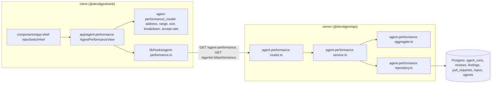
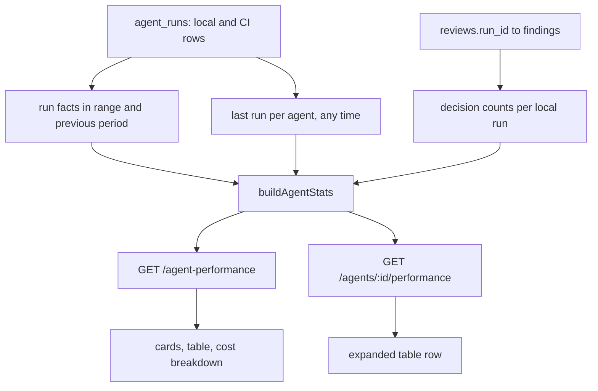
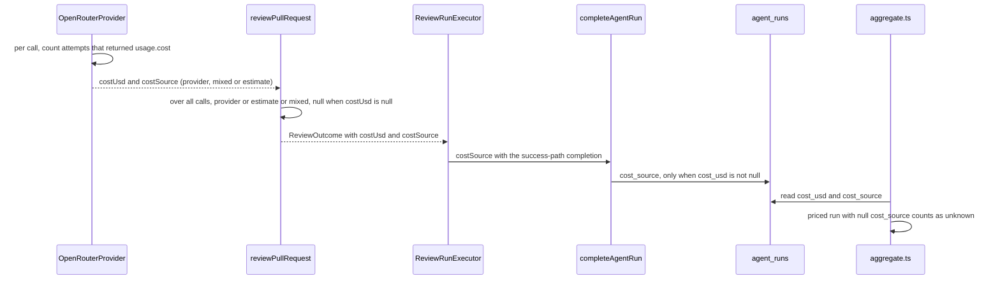
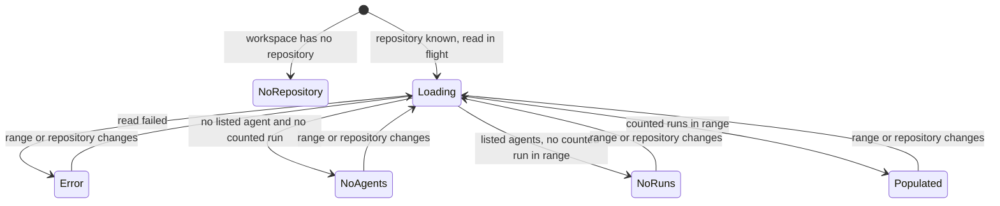

# Agent Performance — how often each agent runs, what it costs and how often its findings are accepted

How the studio summarises the stored runs and finding decisions of every review agent on one
repository over a period: what the `/agent-performance` page shows, the two read-only endpoints
behind it, the single set of aggregation rules both endpoints apply, how the cost of a run is
tagged with its source (provider-reported or estimated), the address state and the states of the
page, the two indexes the reads rely on, and the limits. Read this before touching the
`agent-performance` module, the `agent-performance` contract, the `cost_source` column of
`agent_runs`, `ReviewOutcome.costSource` in reviewer-core, the `/agent-performance` page, its
sidebar item, or the repository switch in the app shell.

Requirements: [`specs/agent-performance-dashboard/spec.md`](../specs/agent-performance-dashboard/spec.md)
(SPEC-10); the plan is
[`specs/agent-performance-dashboard/plan.md`](../specs/agent-performance-dashboard/plan.md) and the
design is
[`designs/1-agent-performance-dashboard.webp`](../specs/agent-performance-dashboard/designs/1-agent-performance-dashboard.webp).
Status: implemented. No test was run while writing this page; see [Tests](#tests).

## What it does

- **One page, one repository, one period.** The page `/agent-performance` (sidebar item **Agent
  Performance**, GLOBAL group, directly above **CI Runs**) shows four summary cards, a table with one
  row per agent and a cost breakdown, all for the repository named in its address (else the active
  repository) and for the chosen range: 1 day, 30 days (the default) or a custom range.
- **Accept rate is the quality signal and always carries its denominator.** A rate is shown as
  `78% · 45/58`; a rate built on 1 to 9 decisions is labelled **Low sample**, coloured neutral and
  sorted after the well-founded rates.
- **Money is split two ways.** By agent and by model, each with a legend whose amounts add up to the
  total, and the card says how much of the total is provider-reported, a DevDigest estimate, mixed or
  of unknown source.
- **Two reads, one set of rules.** `GET /agent-performance` returns everything the page needs;
  `GET /agents/:id/performance` returns one agent, and its numbers equal that agent's row of the first
  read because both call the same function.
- **Nothing is written and no model is called.** Opening, reloading, sorting, expanding a row and
  Refresh only read stored data.

## Where it lives

One box per real module or file:

The module follows the usual layering: `routes.ts` validates the query with the shared Zod schema and
makes one service call; `service.ts` loads facts through the repository port and hands them to
`aggregate.ts`; `aggregate.ts` is pure (no I/O, no Drizzle) and is the only place where a rule lives;
only `repository.ts` touches Drizzle, and its SQL only scopes (workspace, repository, time range, and
a status list passed in). `AgentPerformanceService` has the repository as its only dependency, so the
price book, the model providers and GitHub are not reachable from it
([`container.ts`](../server/src/platform/container.ts)). The module is registered statically in
[`modules/index.ts`](../server/src/modules/index.ts).

The client keeps every rule in plain functions under
[`_model/`](../client/src/app/agent-performance/_model/) and imports only types from
`@devdigest/shared`.

### Data flow

The same stored facts feed both endpoints, and the page sends one overview read per repository and
range plus one detail read per expanded row:

## The page

[`/agent-performance`](../client/src/app/agent-performance/page.tsx) is a thin route; the view is
[`AgentPerformanceView`](../client/src/app/agent-performance/_components/AgentPerformanceView/AgentPerformanceView.tsx).

- **Header.** Title "Agent Performance", the subtitle "Which agents earn their keep — accept rate is
  the quality signal", the line "Repository: `<owner/name>`", the range control, "Data as of
  `<time>`" (the time of the last successful read) and **Refresh**, which reads the same repository
  and range again and is disabled while a read is in flight.
- **Range control.** Three buttons: **1 day**, **30 days**, **Custom range**. Custom shows two date
  fields and **Apply**. An invalid custom range (end before start, end in the future, more than 366
  calendar days, or a missing date) shows an inline error and sends no read.
- **Total runs card.** The number of counted runs and a sparkline of runs per bucket. The label names
  the range: `(1D)`, `(30D)` or `(<start> – <end>)`.
- **Total cost card.** The total, the difference to the previous period with its sign and "vs previous
  period" (or "No previous data" when the previous period has no counted run), one line per cost
  source with a non-zero amount and its whole-percentage share ("Provider-reported", "DevDigest
  estimate", "Mixed", "Source unknown"), "K runs not priced" while at least one counted run has no
  cost, and the note "Agent review runs only — eval runs and other model calls are not included".
- **Avg accept rate card.** The pooled rate as a whole percentage, a ring of the same value, "of N
  decisions", the note "local runs only" and the label "Low sample" when it applies. With no
  decisions it shows "—" and "No decisions yet".
- **Most-active agent card.** The agent's name, its runs and its accept rate with denominator, or "—"
  when no agent has a counted run. It is a button: activating it expands that agent's row, scrolls to
  it and moves focus into it. When the row is already expanded it only scrolls.
- **Agents table.** Columns Agent, Runs (with the range suffix), Failed, Avg cost, Avg dur., Accept,
  Cost / accepted, Last run and a **View** link to `/agents/<id>`. A disabled agent carries the label
  "Disabled". A value that is null is shown as "—", never as 0. Last run is relative time and is
  refreshed on a one-minute tick without a request. The sortable columns are Runs, Avg cost, Avg
  dur., Accept and Last run.
- **Expanded row.** Expanding a row reads that agent through the per-agent endpoint with the exact
  instants the overview applied, and shows the agent's cost by model, its accepted, dismissed and
  undecided findings, its counted runs from local and from CI, and its cost by source (all four
  sources, each with its share of that agent's cost). The row has its
  own placeholders while loading and its own message and **Retry** on error; the rest of the page does
  not change.
- **Cost breakdown.** Two donut charts, **By agent** and **By model**, each with a text legend of
  every slice (name, amount, whole-percentage share). The donut shows the 6 largest slices and one
  "Other" segment when there are more; the legend still lists every slice. Counted runs of a deleted
  agent form one "Deleted agent" slice; priced runs with no stored model form one "Unknown model"
  slice. When every counted run is unpriced, the charts give way to "No priced runs in this period".
  When priced runs add up to exactly 0 (free models), the legend shows `$0.000` and `0%` next to one
  neutral ring.
- **Sorting.** The default is Accept, descending. Activating a header sorts by that column
  (descending first) and activating it again toggles the direction. Accept orders rates with 10 or
  more decisions first, then low-sample rates, then rows with no rate, in both directions; every
  other column puts rows with no value last in both directions. Ties are ordered by agent name.

The design shows trend arrows next to the accept rate and a Memory item in the sidebar; neither is
built (see [Known limitations](#known-limitations)). The Failed and Cost / accepted columns are
additions to the design.

## The two reads

Both are `GET`, both read stored data only, both are covered by the app-wide rate limit (120 per
minute; there is no per-route override, and the limit is off under `NODE_ENV=test`, see
[`app.ts`](../server/src/app.ts)).

| Endpoint | Returns |
|---|---|
| `GET /agent-performance?repoId=&from=&to=` | `AgentPerformanceOverview` for the repository and range |
| `GET /agents/:id/performance?repoId=&from=&to=` | `AgentPerformanceDetail` for one agent, enabled or disabled |

**Query.** `repoId` is a UUID; `from` and `to` are ISO-8601 instants with `Z` or an offset. `from` is
inclusive and `to` is exclusive: a run is in the range when `from ≤ ran_at < to`, by its start time.
The client sends "1 day" as `now − 24 h` to `now`, "30 days" as `now − 30 × 24 h` to `now` (where "now"
is the moment the read is sent), and a custom range as local midnight of the start date to local
midnight of the day after the end date, in the browser's time zone.

**Errors.**

| Status | When |
|---|---|
| 422 `validation_error` | `repoId`, `from` or `to` is missing; `repoId` or `:id` is not a UUID; `from` or `to` is not an ISO-8601 instant; `from` is not before `to`; or `to − from` exceeds 366 × 24 h plus 1 h (one daylight-saving shift). Rejected before the handler, so no query runs. |
| 404 | The repository (either endpoint) or the agent (detail) does not exist in the caller's workspace. The detail endpoint checks the agent first. |

An agent of the workspace with no counted run answers 200 with `runs` 0, `failed` 0, null averages, a
null accept rate with `decisions` 0 and an empty `cost_by_model`.

### Response fields

Defined in [`agent-performance.ts`](../server/src/vendor/shared/contracts/agent-performance.ts)
(canonical in `server/src/vendor/shared`; `client/src/vendor/shared` holds an identical copy and the
two change together). Field names are snake_case.

| Contract | Holds |
|---|---|
| `AgentPerformanceOverview` | `repo` (`id`, `full_name`), `range` (`from`, `to`, the instants applied), `totals`, `previous_period`, `buckets`, `rows`, `cost_by_agent`, `cost_by_model` |
| `totals` | `runs`, `failed`, `total_cost_usd`, `not_priced_runs`, `cost_by_source` (`provider`, `estimate`, `mixed`, `unknown`), `accept` (an `AcceptStats`, pooled), `most_active` (`agent_id`, `name`, `runs`, `accept`) or null |
| `previous_period` | `total_cost_usd`, `has_runs` |
| `buckets` | `{ start, runs }[]`; `start` is an ISO instant |
| `AgentPerformanceRow` | `agent_id`, `name`, `enabled`, `runs`, `failed`, `avg_cost_usd` (nullable), `avg_duration_ms` (nullable), `accept`, `last_run_at` (nullable), `cost_per_accepted_usd` (nullable) |
| `AcceptStats` | `rate` (nullable), `accepted`, `dismissed`, `decisions` (`accepted + dismissed`), `low_sample` |
| `AgentCostSlice` | `agent_id`, `name`, `cost_usd`; both ids null for the deleted-agent slice |
| `ModelCostSlice` | `model`, `cost_usd`; `model` null for the unknown-model slice |
| `AgentPerformanceDetail` | every `AgentPerformanceRow` field plus `repo`, `range`, `cost_by_model`, `not_priced_runs`, `cost_by_source`, `undecided`, `runs_by_source` (`local`, `ci`) |

Amounts are unrounded USD; rounding happens only in the client.

## Aggregation rules

All rules live in [`aggregate.ts`](../server/src/modules/agent-performance/aggregate.ts) (thresholds
and the status list in [`constants.ts`](../server/src/modules/agent-performance/constants.ts)).
`buildAgentStats` is the single implementation of one agent's numbers; the overview calls it for
every listed agent and the detail read calls it for the requested one.

### Which runs count

- **A run belongs to a repository** when it is a local run whose pull request belongs to that
  repository, or a CI run whose recorded `owner/name` equals the repository's full name compared
  without regard to letter case
  ([`repository.ts`](../server/src/modules/agent-performance/repository.ts), `runScope`). A local
  run whose pull request is gone (`pr_id` is set to null when a pull request is deleted) and a CI run
  of a repository that is not imported belong to no repository and are not shown.
- **A counted run** belongs to the repository, starts inside the range, is of the caller's workspace,
  has the status `done`, `failed` or `cancelled`, and has the source `local` or `ci`. A run that is
  `running` is never counted; it appears after a Refresh once it has ended. A run is counted with its
  final stored status, so a run that was cancelled and then ended `done` counts as `done`, and a run
  reaped as `failed` on API boot counts as `failed`.
- **Multi-agent runs.** Each agent run of a multi-agent run is one run of its own agent, like a
  single-agent run.
- **Period.** The period is decided by the run's start time (`ran_at`), not by when it ended or
  when a finding was decided. A run that started before `from` and ended inside the range is not
  counted.

### Per-agent numbers

| Number | Rule |
|---|---|
| Runs | counted runs of the agent |
| Failed | counted runs with status `failed` |
| Avg cost | mean cost over the agent's counted `done` runs that have a cost; null when there is none |
| Avg duration | mean duration over the agent's counted `done` runs that have a duration; null when there is none |
| Accept rate | `accepted / (accepted + dismissed)` over the findings of the reviews produced by the agent's counted **local** runs; null when the denominator is 0 |
| Low sample | the denominator is between 1 and 9 (`MIN_DECISIONS` is 10) |
| Cost / accepted | sum of the costs of the agent's counted local runs that have a cost, divided by `accepted`; null when `accepted` is 0 or no such run has a cost |
| Last run | the latest start time among all of the agent's runs on this repository with status `done`, `failed` or `cancelled`, of any source and at any time, inside the range or not; null when there is none |

Averages use `done` runs only, so failed and cancelled runs do not drag them down; they still count in
Runs and Failed.

### Costs

- **Total cost** is the sum of the recorded costs of the counted runs that have a cost. A run with a
  null cost adds nothing and is never treated as 0. The number of counted runs without a cost is
  returned as `not_priced_runs` and shown as "K runs not priced". This includes failed and cancelled
  runs, which normally have no cost.
- **Cost by source** sums the same costs by `cost_source`; a priced run with no stored source is added
  under `unknown`. The four amounts add up to `total_cost_usd`.
- **Breakdowns.** `cost_by_agent` sums each agent's counted-run costs and `cost_by_model` sums them per
  stored model name; each adds up to the total, on unrounded values. Slices are ordered by amount
  descending, then by name; the deleted-agent slice sorts after the named agents on a tie of amounts.
  Only agents and models with at least one priced run have a slice.
- **Previous period.** The window `[from − (to − from), from)` on the same repository, with the same
  counting rules. The response carries only its total cost and whether it has any counted run.

### Accept rate

- **Decisions as stored at the time of the read.** A finding is accepted when `accepted_at` is set,
  dismissed when `dismissed_at` is set and `accepted_at` is not, and undecided when neither is set.
  Undecided findings are excluded from the rate and returned only by the detail read (`undecided`).
- **Findings are attributed through `reviews.run_id`.** A review without a run id contributes to no
  agent. Findings of every `kind` count.
- **Local runs only.** CI runs contribute no findings, so a CI-only agent has runs and cost but no
  rate. The card and the column header say "local runs only".
- **Avg accept rate** is pooled, `Σ accepted / Σ (accepted + dismissed)`, over the findings of all
  counted local runs, including those of deleted agents. It is not a mean of the per-agent rates.

### Which agents are listed

The table lists every enabled agent of the workspace, plus every disabled agent with at least one
counted run in the repository and range. Rows are ordered by name (case-insensitive, then by exact
code points, then by id); the page re-sorts them. Counted runs of a deleted agent (`agent_id` is set to
null when an agent is deleted) count in every total but have no row and are never the most-active
agent. A renamed agent shows its current name; runs stay attributed by id.

**Most-active agent.** The listed agent with the most counted runs; on a tie the one with the latest
Last run, then the first by name. There is none while no listed agent has a counted run.

### Buckets (the sparkline)

The range is split into consecutive buckets that start at `from`: one-hour buckets when the span is
24 hours or less, 24-hour buckets otherwise. The count is `ceil(span / bucket size)`, so the last
bucket is cut at `to` when the span is not a multiple (for example a 23-hour or 25-hour daylight-saving
day). Each counted run falls into one bucket, and the bucket counts add up to `totals.runs`.

### Determinism

Every query has a total `ORDER BY` (runs by `ran_at, id`; agents by `name, id`), names are compared by
code point rather than by locale, and sums are accumulated in a fixed order. The same stored data,
repository and range give the same values and the same row, slice and bucket order.

## Cost source

A run's cost is either **provider-reported** (OpenRouter's `usage.cost`, the amount the provider
returned with the call) or a **DevDigest estimate** from the price book. The agent run row records
which, in `agent_runs.cost_source`: `provider`, `estimate` or `mixed`. The page reads that value; it
never reconciles anything with a provider invoice or billing API.

- **Per call** ([`openrouter.ts`](../reviewer-core/src/llm/openrouter.ts)): a call may take several
  attempts (schema repair). `costSource` is `provider` when every attempt returned a cost, `mixed`
  when some did, and `estimate` when none did.
- **Per run** ([`run.ts`](../reviewer-core/src/review/run.ts)): over all model calls of the run,
  `provider` when every call is `provider`, `estimate` when none is `provider` or `mixed`, otherwise
  `mixed`; `null` when the run's cost is null. A provider adapter that sets no `costSource` (the
  OpenAI and Anthropic adapters, mocks) counts as an estimate. The optional field is declared as
  `RunCostSource` on `StructuredResult` in
  [`adapters.ts`](../server/src/vendor/shared/adapters.ts).
- **Stored** ([`run.repo.ts`](../server/src/modules/reviews/repository/run.repo.ts)):
  `completeAgentRun` writes `cost_source` only together with a non-null cost. The success path of
  [`run-executor.ts`](../server/src/modules/reviews/run-executor.ts) passes the outcome's value; the
  failure and cancel paths pass no cost, so those rows have no cost source.
- **Read.** A priced run whose `cost_source` is null is read as `unknown`. This covers every local run
  that ended before the column existed (the migration does not backfill) and every CI run (the CI
  collector and the runner artifact are unchanged). A run with no cost has no source and is counted
  as not priced.

The Total cost card therefore shows how sure the number is: only the "Provider-reported" line is the
amount the provider returned; "DevDigest estimate" and "Mixed" are not an invoice; "Source unknown"
is old or CI cost.

## Read-only guarantee

Both endpoints only read stored repositories, pull requests, agents, runs, reviews and findings. They
write nothing, start no review run, and make no model, embedding, price look-up, GitHub or other
network request; costs are taken as stored. This holds by construction (the service has no dependency
other than the repository) and by test
([`agent-performance-readonly.it.test.ts`](../server/test/agent-performance-readonly.it.test.ts)
counts rows before and after, spies on the model, GitHub and price-book entry points of the
container, and traps `fetch`). On the page, every request is a `GET` of these two endpoints, with no
polling and no refetch on window focus
([`agent-performance.ts`](../client/src/lib/hooks/agent-performance.ts): `staleTime` 0,
`refetchOnWindowFocus` false, `refetchOnMount` always, `retry` false). The only things that trigger a
read are opening the page, changing the repository, range or address, Refresh, Retry, and expanding a
row.

Tenancy: every repository method filters by the caller's workspace, and a repository or agent of
another workspace answers 404.

## Page address

The page keeps its state in the query string, so a reload or a shared link shows the same view
([`address.ts`](../client/src/app/agent-performance/_model/address.ts),
[`usePageAddress.ts`](../client/src/app/agent-performance/_components/AgentPerformanceView/usePageAddress.ts)).
Defaults are omitted.

| Parameter | Values | Default |
|---|---|---|
| `repo` | a repository id of the workspace | the active repository (written into the address once known) |
| `range` | `1d`, `30d`, `custom` | `30d` |
| `start`, `end` | `YYYY-MM-DD`, with `range=custom` | — |
| `sort` | `accept`, `runs`, `avg_cost`, `avg_duration`, `last_run` | `accept` |
| `dir` | `desc`, `asc` | `desc` |
| `expanded` | the id of a listed agent | none |

An invalid part is replaced by its default, the other parts are kept, the address is rewritten with
`router.replace`, and a notice names what was reset ("Reset to default: repository, range, …"). A
`repo` that is not in the workspace, a range the range rules reject, an unknown sort column or
direction, and an `expanded` that names no listed agent are invalid. `expanded` is judged only once
the overview has loaded. The notice disappears at the next change the user makes.

Selecting another repository in the sidebar selector stays on the page: the shell's
[`repoSwitchHref`](../client/src/components/app-shell/helpers.ts) keeps the other parameters, sets
`repo` and drops `expanded`, so the row collapses. On every other page the selector still opens the
repository's pull requests. The page in turn keeps the sidebar's active repository in step with a
valid `repo` in its address. The nav item itself links to `/agent-performance?repo=<active>`
([`nav.ts`](../client/src/vendor/ui/nav.ts)).

## Page states

Refresh and Retry read the same repository and range again. A Refresh keeps the data already shown
until the new answer arrives.

| State | What the page shows |
|---|---|
| No repository | "No repository yet" with an "Import a repository" link, in place of the cards, table and breakdown. No read is sent and the range control is hidden. |
| Loading | Placeholders in the cards, the table and the breakdown, with no number, no zero and no "—". |
| Error | "Could not load agent performance." with **Retry**, in place of the cards, table and breakdown. The range control and Refresh stay usable. |
| No agents | "No agents yet" with a link to the Agents page, in place of the cards, table and breakdown. It is chosen when the overview has no row and no counted run, so a workspace whose agents are all disabled and idle shows it too. |
| No runs in range | The cards (Total runs 0; Avg accept rate and Most-active agent "—") and, in place of the table and breakdown, "No agent runs on `<owner/name>` in this period" with the hint "Choose a longer range." |
| Populated | Cards, table and breakdown. An agent with no counted run while others have some shows Runs 0, Failed 0 and "—" in Avg cost, Avg dur., Accept and Cost / accepted. |

## Accessibility

- The range control, the sort headers, the row buttons, the Most-active card, **View**, **Refresh** and
  **Retry** are real buttons or links, operable by keyboard, with accessible names. Each sort header
  exposes `aria-sort`; each row button exposes `aria-expanded`.
- The sparkline and the donuts are hidden from assistive technology and have text equivalents with
  the same values (a visually hidden list of the bucket counts, and the legends). The ring has an
  accessible label with its percentage.
- Colour never carries meaning alone. "Low sample" is a text label. An accept rate coloured green
  (70% or more), amber (50 to 69%) or red (below 50%), by its unrounded value, carries the description
  "High (≥70%)", "Medium (50–69%)" or "Low (<50%)" as a `title`, as visually hidden text and as a
  bubble shown on keyboard focus. A low-sample rate is neutral and has no quality description.
- Long agent, model and repository names are truncated with the full name on hover and on keyboard
  focus ([`FocusTip`](../client/src/app/agent-performance/_components/FocusTip/FocusTip.tsx)). The
  letter avatar of an agent is decorative.
- Agent, model and repository names are rendered as plain text. No finding text, review summary or log
  is shown by this feature; the expanded row shows only counts, amounts and model names.

## Database

Two migrations, both generated by drizzle-kit:

| Migration | Change | Why |
|---|---|---|
| [`0018_kind_peter_parker.sql`](../server/src/db/migrations/0018_kind_peter_parker.sql) | `agent_runs.cost_source` text, nullable; index `agent_runs_ws_ran_idx` on (`workspace_id`, `ran_at`) | The column records the cost source of a local run; null means no cost or a run from before the column. The index serves every read's filter, workspace plus time range, over all sources (the existing CI index is partial on `source = 'ci'`). |
| [`0019_third_network.sql`](../server/src/db/migrations/0019_third_network.sql) | index `reviews_run_idx` on `reviews(run_id)`; index `findings_review_idx` on `findings(review_id)` | The decision counts join `agent_runs`, `reviews.run_id` and `findings.review_id`; neither column was indexed. [`agent-performance-cold-stats.it.test.ts`](../server/test/agent-performance-cold-stats.it.test.ts) records that on a database loaded without `ANALYZE`, a read took about 17 seconds before this migration, and asserts both reads stay under 2 seconds with the indexes. |

`cost_source` is a text column with the values `provider`, `estimate` and `mixed`; there is no
database-level default and no backfill. Migrations are not applied on boot: run `pnpm db:migrate` in
`server/`.

## Tests

No test was run while writing this page; what follows is what the suites assert, taken from their
code.

- **reviewer-core** ([`cost-source.test.ts`](../reviewer-core/test/cost-source.test.ts),
  [`openrouter-cost-source.test.ts`](../reviewer-core/test/openrouter-cost-source.test.ts)): the
  provider, estimate, mixed and null aggregation over single-pass and map-reduce, and `usage.cost`
  present, absent or present on one of two attempts. `cd reviewer-core && npm test`.
- **server, unit** (`cd server && pnpm exec vitest run --exclude '**/*.it.test.ts'`):
  [`agent-performance-aggregate.test.ts`](../server/test/agent-performance-aggregate.test.ts) (the
  rules above on fixture facts), `agent-performance-contracts.test.ts` (every invalid query shape),
  `agent-performance-routes.test.ts` (422 before the handler, and the service reached with the
  caller's workspace).
- **server, integration** (`cd server && pnpm exec vitest run .it.test`, needs Docker; they self-skip
  without it): `agent-performance.it.test.ts` (both endpoints on a real Postgres, workspace and
  repository scoping, and that every overview row equals the per-agent read),
  `agent-performance-readonly.it.test.ts`, `agent-performance-perf.it.test.ts` and
  `agent-performance-cold-stats.it.test.ts` (10,000 counted runs in the range and 10,000 in the
  previous period, each read under 2 seconds, two reads deep-equal), `run-cost-source.it.test.ts`
  (the stored `cost_source` of provider, estimate, mixed, failed and unpriced runs). Shared seeding is
  in `server/test/helpers/agent-performance.ts`.
- **client** (`cd client && pnpm test`, then `pnpm typecheck`): the `_model/` functions, every
  component folder of the page, the hooks
  ([`agent-performance.test.tsx`](../client/src/lib/hooks/agent-performance.test.tsx): instants are
  resolved at send time, Refresh recomputes "now", no refetch on focus), the sidebar item and the
  repository switch.
- **Not covered by a test:** the rate limit (it is off under `NODE_ENV=test`), the visual match to the
  design, and a pass with a real screen reader.

## Known limitations

These are the behaviours of the current code, not goals.

1. **The scope is one repository.** There is no workspace-wide view and no repository filter; the
   repository selector of the sidebar is the only switch.
2. **Only agent review runs.** Eval suite runs and the model calls of features without an agent (PR
   brief, intent, conventions, onboarding) are not counted, and the Total cost card says so.
3. **No Stats tab.** The per-agent endpoint is built and the expanded row uses it, but the agent
   editor has no Stats tab.
4. **No live updates.** The page reads when it opens, when the repository, range or address changes,
   and on reload, Refresh or Retry. A run that is still `running` is not counted until a later read.
5. **No billing reconciliation.** "Provider-reported" is the cost the provider returned with the
   call; nothing is compared with an invoice.
6. **A `mixed` cost is not a complete cost.** When some attempts of one call return a cost and others
   do not, the call's stored cost is the sum of the reported costs only; the code adds no estimate for
   the attempts that returned none ([`openrouter.ts`](../reviewer-core/src/llm/openrouter.ts)).
7. **Older and CI cost has no source.** Local runs that ended before migration 0018 and every CI run
   read as "Source unknown". The CI runner artifact does not carry a cost source.
8. **Accept rate counts local runs only.** CI runs contribute runs, failures, cost and duration, but no
   findings; "Cost / accepted" likewise uses local runs only.
9. **Reviews without a run id are invisible to the rate.** Findings are attributed through
   `reviews.run_id`.
10. **No trend arrows and no Memory item.** The design shows both; this feature adds neither. The
    Multi-Agent Review item stays in the WORKSPACE group.
11. **Rounding is display only.** Legend amounts and whole percentages can differ from the total by a
    cent or a point. The unrounded values add up, and the tests compare the sums with a
    floating-point tolerance of 1e-9.
12. **The 366-day bound.** A custom range longer than 366 calendar days is rejected by the page and, at
    the API, a span above 366 × 24 hours plus 1 hour is rejected with 422.
