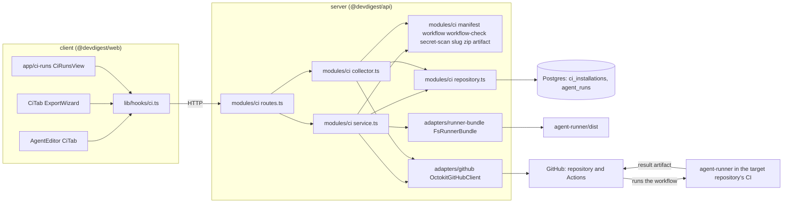
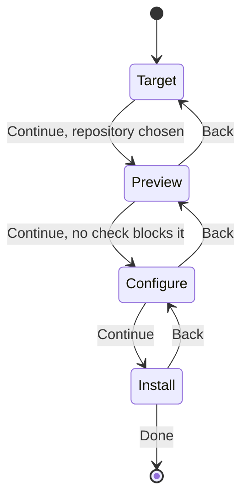
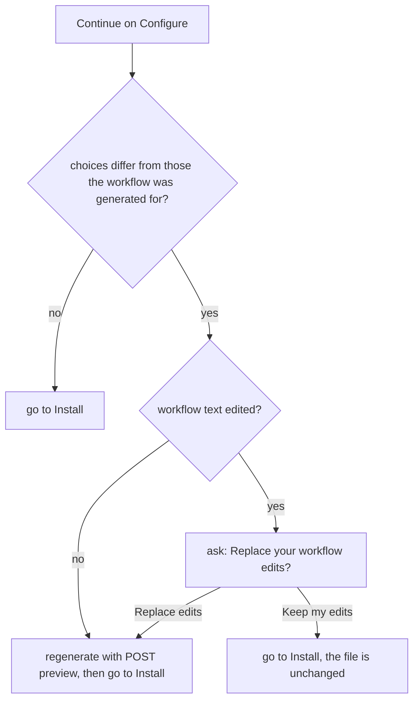
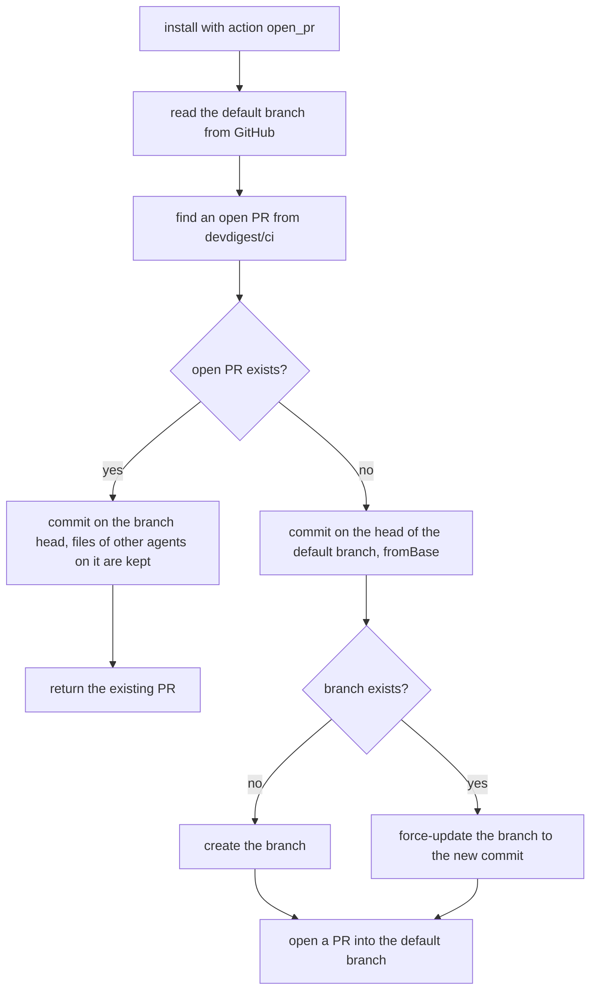
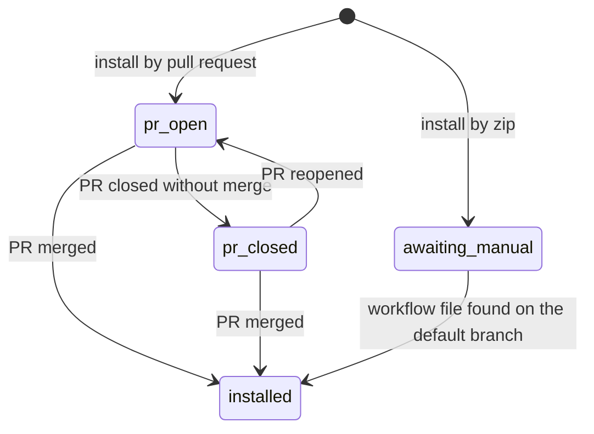
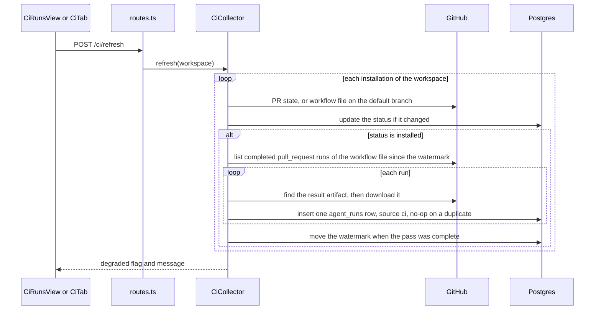
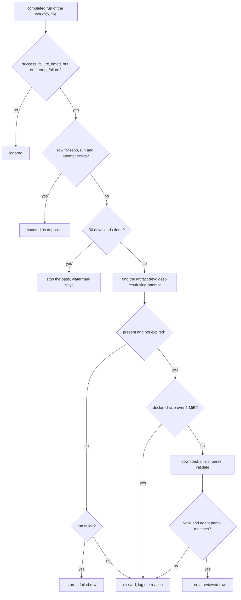
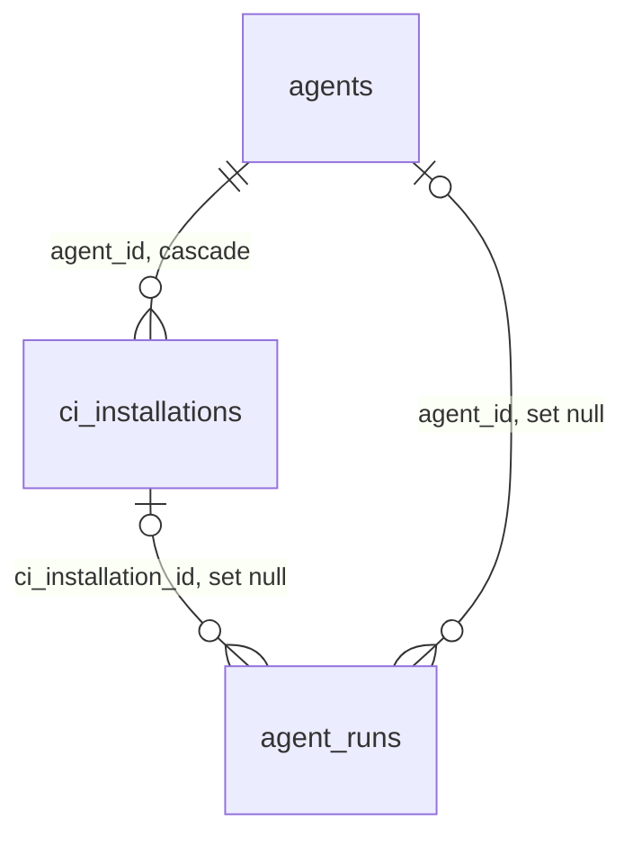

# Export to CI — running a studio agent on pull requests in GitHub Actions

How the studio takes a review agent that was tuned locally and installs it into an imported
repository's GitHub Actions, and how the results of those CI runs come back: the agent manifest and
the one schema that both the studio and the CI runner validate it with, the four-step Export Wizard
and the checks it runs on the editable workflow file, the generated workflow, the two install paths
(pull request or zip) and the installation statuses, the pull-based collection of results, what is
stored for a CI run, the HTTP surface, the runner, the GitHub token permissions the feature needs,
and its security properties and limits. Read this before touching the `ci` module, the `AgentManifest`
and `CiResultArtifact` contracts, the `agent-runner` package, the runner-bundle adapter, the CI tab
of the agent editor, the Export Wizard or the `/ci-runs` page.

Requirements: [`specs/export-to-ci/spec.md`](../specs/export-to-ci/spec.md) (SPEC-08); the
implementation plan is [`specs/export-to-ci/plan.md`](../specs/export-to-ci/plan.md) and the design
review is [`specs/export-to-ci/design-review.md`](../specs/export-to-ci/design-review.md).

## What it does

An agent that lives only in the studio runs on its author's machine, on demand. Export to CI makes
the same agent review every pull request of a repository without the author:

- **The agent becomes files in the target repository.** A manifest
  `.devdigest/agents/<agent-slug>.yaml`, one `.devdigest/skills/<skill-slug>.md` per linked skill, an
  empty `.devdigest/memory.jsonl`, the bundled runner under `.devdigest/runner/` and a workflow
  `.github/workflows/devdigest-review-<agent-slug>.yml`.
- **The files arrive through a pull request** from the branch `devdigest/ci` into the repository's
  default branch, or as a zip the user adds by hand. The studio never merges the pull request, never
  configures branch protection and never creates repository secrets; the wizard lists these as next
  steps.
- **The CI runs come back by being pulled.** The studio reads the workflow runs and their result
  artifacts from GitHub with its own GitHub token. There is no endpoint through which CI pushes a
  result in, because the studio has no authentication (`LocalNoAuthProvider`, see
  [`server/docs/architecture.md`](../server/docs/architecture.md)).
- **Each CI run is an `agent_runs` row with `source = 'ci'`**, listed on the CI Runs page and on the
  agent's CI tab with its verdict, findings count, cost, duration, a link to the run on GitHub and
  trace data that explains why two runs of one manifest can differ.
- **Same configuration, not the same output.** The manifest guarantees the same model, system prompt,
  skills and parameters. Model output and the tool versions in CI can differ, which is why the trace
  records them. See [Known limitations](#known-limitations).

Only GitHub Actions has a generator. The Target step shows CircleCI, Jenkins and Generic CLI as
disabled cards labelled "Coming soon". Only agents with the provider `openrouter` can be exported.

## Where it lives

One box per real module or folder:



`modules/ci` is registered statically in [`modules/index.ts`](../server/src/modules/index.ts) (key
`ci`). `CiService` ([`service.ts`](../server/src/modules/ci/service.ts)) takes ports, not the
container ([`types.ts`](../server/src/modules/ci/types.ts)): the CI repository, an agents port (the
saved agent and its linked skills), a secrets port that answers only "is a secret of this name
configured", `github()`, the runner bundle and a clock. `CiCollector`
([`collector.ts`](../server/src/modules/ci/collector.ts)) takes the repository, `github()` and a
clock. [`container.ts`](../server/src/platform/container.ts) assembles both once
(`container.ciService`, `container.ciCollector`); the collector is a singleton because it coalesces
concurrent refreshes. Only [`repository.ts`](../server/src/modules/ci/repository.ts) touches Drizzle.
[`manifest.ts`](../server/src/modules/ci/manifest.ts), [`workflow.ts`](../server/src/modules/ci/workflow.ts),
[`workflow-check.ts`](../server/src/modules/ci/workflow-check.ts),
[`secret-scan.ts`](../server/src/modules/ci/secret-scan.ts), [`slug.ts`](../server/src/modules/ci/slug.ts),
[`zip.ts`](../server/src/modules/ci/zip.ts), [`artifact.ts`](../server/src/modules/ci/artifact.ts) and
[`helpers.ts`](../server/src/modules/ci/helpers.ts) are pure: text in, text or findings out.

The GitHub port gained the Actions capabilities the feature needs
([`adapters.ts`](../server/src/vendor/shared/adapters.ts)): `getDefaultBranch`,
`listActionsSecretNames`, `listWorkflowRuns`, `findRunArtifact`, `downloadArtifact`,
`fileExistsOnBranch`, `getPullRequestState`, a `fromBase` option on `commitFiles`, and a PR number on
`openPullRequest` and `findOpenPr`. The adapter is
[`octokit.ts`](../server/src/adapters/github/octokit.ts); it maps every failure to an
`ExternalServiceError` carrying GitHub's message and HTTP status only, never request headers (they
hold the token), and a 403/404 on a permission-sensitive read to `GitHubPermissionError`.

The runner bundle is read through the `RunnerBundle` port
([`adapters/runner-bundle/`](../server/src/adapters/runner-bundle/index.ts)): `FsRunnerBundle` lists
and reads every regular file under `agent-runner/dist/` (resolved from the adapter file, not the
working directory) and requires `index.js`. **The bundle must be built** (`cd agent-runner && pnpm
build`) before a preview or an install can work; otherwise the API answers 500 `config_error` with
that instruction.

The contract is [`contracts/eval-ci.ts`](../server/src/vendor/shared/contracts/eval-ci.ts), canonical
in `server/src/vendor/shared` with an identical copy in `client/src/vendor/shared` that must change
together with it. The client imports types only from `@devdigest/shared` (a value import blanks the
page, see [`client/INSIGHTS.md`](../client/INSIGHTS.md)), so the client repeats the small enums
(triggers, "Post results as", "Fail CI on") locally.

## The manifest

The manifest is the agent as the runner needs it. Its schema, `AgentManifest` in
[`contracts/eval-ci.ts`](../server/src/vendor/shared/contracts/eval-ci.ts), is **one Zod schema used
by both ends**: the studio imports it from `@devdigest/shared`, and the runner imports it through the
tsconfig alias `@devdigest/shared` → `server/src/vendor/shared`
([`agent-runner/tsconfig.json`](../agent-runner/tsconfig.json)), so the format cannot drift.

| Key | Type | Notes |
|-----|------|-------|
| `name` | string, non-empty | The agent's name at export time. CI results are matched to the installation on it. |
| `version` | integer ≥ 1 | The saved agent version the manifest was built from. |
| `provider` | `Provider`, default `openrouter` | The studio refuses to export any other provider. The runner always builds an OpenRouter provider and does not read this key. |
| `model` | string, non-empty | |
| `system_prompt` | string | |
| `skills` | list of skill slugs, in the agent's skill order | A missing key or an explicit `null` reads as `[]`. |
| `strategy` | `auto`, `single-pass` or `map-reduce`, default `auto` | |
| `ci_fail_on` | `never`, `critical`, `warning` or `any`, default `critical` | The gate policy applied by the runner. |

The manifest carries neither the triggers nor "Post results as" (those live in the workflow), and no
secret.

```yaml
name: Security reviewer
version: 4
provider: openrouter
model: vendor/model-name
system_prompt: |-
  You review pull requests for security problems.
skills:
  - owasp-checklist
strategy: auto
ci_fail_on: critical
```

**How it is built.** [`buildManifestYaml`](../server/src/modules/ci/manifest.ts) takes the agent's
**last saved version** (unsaved edits in the Config tab are not exported), validates the object with
`AgentManifest`, serializes it with the `yaml` package, then parses the text back, validates it again
and requires the result to equal the input exactly. A system prompt or skill name that tried to add or
change keys therefore fails instead of shipping. A failure makes the API answer 422 "The agent
manifest could not be generated" with the reason, and no files.

**Slugs.** The agent slug and every skill slug match `^[a-z0-9][a-z0-9-]*$` and are at most 60
characters ([`slug.ts`](../server/src/modules/ci/slug.ts)): the name is normalised (accents
stripped, lower case, runs of other characters become `-`), an empty result falls back to `agent` or
`skill`, and a clash gets `-2`, `-3`, …. Skill slugs are made unique inside one agent. The agent slug
of an installation is **fixed at its first export**: a re-export of the same agent to the same
repository reuses it, even after the agent is renamed; a new installation avoids the slugs of the
other installations in that repository.

**Skill files and the memory file.** Each linked skill is written as `.devdigest/skills/<slug>.md`
with the skill body unchanged. `.devdigest/memory.jsonl` is created empty (0 bytes) and the runner
never reads it. A skill file path depends only on the skill's slug, so two agents in one repository
that link skills with the same slug share one file, and the last export wins (the trace's skill hashes
show the change).

## The Export Wizard

The wizard is a modal dialog opened from the agent's CI tab ("Add to CI", the dashed "Add
repository" row, "Update CI config" or a row's "Update"). It is
[`ExportWizard`](../client/src/app/agents/[id]/_components/AgentEditor/_components/CiTab/_components/ExportWizard/ExportWizard.tsx)
with the state in `useExportWizard` and one component per step under `steps/`. Its title is "Export to
CI" and its subtitle "Run <agent name> automatically on pull requests". The stepper shows Target →
Preview → Configure → Install; the current step carries `aria-current="step"`, done steps a check and
hidden "completed" text, later steps hidden "not yet reached" text.



Back keeps every choice and every edit, because the state lives above the step components. Closing
the wizard (the close button or Escape) discards its state and writes nothing anywhere; when the
workflow file was edited and no install has succeeded, it first asks "Discard your workflow edits?"
with "Discard" and "Keep editing". An install request in flight blocks Back and closing. Focus is
trapped inside the dialog, moves in when it opens and returns to the opener when it closes
(`useDialogFocus`).

### Target

"GitHub Actions" (badge "recommended", "Runs on pull_request events") is selected; the other three
targets are disabled. A repository picker lists the workspace's imported repositories as `owner/name`,
the active repository preselected, and marks the ones where this agent is already installed
"installed". With no imported repository the picker is empty, links to the import page and "Continue"
stays disabled with the reason. When the agent's provider is not `openrouter`, an alert gives the
reason and "Continue" is disabled.

### Preview

The first entry generates the files with `POST /agents/:id/ci/preview` and lists, under "FILES TO
CREATE", exactly what Install would commit or zip, in this order: the manifest, one skill file per
linked skill, `.devdigest/memory.jsonl`, every file of the runner bundle under `.devdigest/runner/`,
and the workflow. Selecting a file shows its path and contents; the workflow is marked "editable" and
is a text area, everything else is "read-only", and the runner bundle shows only its size, never its
contents (the API sends none). A note reads "Not carried into CI: project context documents (N), repo
intel", N being the number of context documents attached to the agent.

**Checks on the workflow text.** Once a preview exists, the wizard sends the current workflow text
with the current repository, triggers and "Post results as" to `POST /agents/:id/ci/check` (debounced
by 400 ms, and a result counts only for the exact inputs it was computed for) and shows the outcome on
the Preview and Install steps.

| Check | What the user sees | Effect |
|-------|--------------------|--------|
| The text is not valid YAML | "Not valid YAML (line N): message" | "Continue" and "Install" disabled |
| A secret-like value in any exported file (manifest, skills, workflow) | The file, the line and the line with the value masked | "Continue" and "Install" disabled until the file no longer contains it |
| A risky construct (below) | A list, each with its kind (Trigger, Permission, Fork pull requests) and detail, and the checkbox "I understand the risk" | "Continue" and "Install" disabled until the box is ticked |
| The check request itself fails | "The workflow file could not be checked. Try again." and "Check again" | Disabled until a check succeeds |

The risky constructs ([`checkWorkflow`](../server/src/modules/ci/workflow-check.ts)): a trigger that is
not `pull_request`, or no `pull_request` trigger at all; a permission beyond `contents: read` and
`pull-requests: write` (a `none` value, and `pull-requests: read`, are within the allowance; a string
permission such as `write-all` is not); a job with no permissions when the workflow declares none,
which would inherit the repository default; and a job without a fork skip. A fork skip is recognised
only as `github.event.pull_request.head.repo.full_name == github.repository`,
`...head.repo.fork == false` or `!...head.repo.fork`, and an `||` anywhere in the condition does not
count. The workflow the studio generates passes the check with no risks.

The secret scan ([`secret-scan.ts`](../server/src/modules/ci/secret-scan.ts)) is a set of regular
expressions over each text file: AWS (`AKIA…`), Google (`AIza…`), GitHub (`ghp_`-style and
`github_pat_`), npm, Slack, OpenRouter (`sk-or-v1-…`) and OpenAI-style (`sk-…`) keys, PEM private key
headers, passwords inside MongoDB URLs, and a quoted literal of 8 or more characters assigned to a
name containing `key`, `secret`, `token` or `password`. `${{ secrets.X }}` references are not
literals. It reports one finding per offending line, with the secret part replaced by its first four
characters and asterisks. It scans the manifest, the skill files, the memory file and the workflow,
not the runner bundle.

### Configure

- **Triggers** are three toggle buttons exposing `aria-pressed`: `pull_request:opened` and
  `pull_request:synchronize` pressed by default, `pull_request:reopened` not. With none pressed,
  "Continue" is disabled with "Select at least one trigger".
- **Secrets expected** lists `OPENROUTER_API_KEY` ("Your OpenRouter key") with the status set, not set,
  checking or unknown, and `GITHUB_TOKEN` ("Auto-provided by Actions") with the status ready, then
  "Add these to your repo's Actions secrets before the workflow runs." The status comes from
  `GET /agents/:id/ci/secrets?repo=`, which reads secret **names** only. Without a studio GitHub token,
  or when GitHub refuses the read (403/404), or when the lookup fails, the status is "unknown" — never
  "not set" for something that was not read.
- **Post results as** is a radio group: "GitHub review" (badge "recommended", the default), "PR comment"
  and "None (exit code only)".
- A note says that merges are blocked by setting "Fail CI on" on the CI tab and adding the workflow's
  check as a required status check in branch protection.

### Regenerating the workflow

The workflow is generated at Preview, before Configure, so the Configure choices can arrive after the
user edited the file. The wizard remembers the choices (repository, triggers, "Post results as") the
current workflow was generated for. Leaving Configure with different choices:



Regeneration calls the preview route again and replaces the whole preview, including the manifest, so
it reflects the agent's current saved version. When edits were kept over changed choices, the Install
step states that the triggers and "Post results as" chosen in Configure are not applied to the file.
Entering Preview again with changed choices and no edits also regenerates.

### Install

Two options. "Open a PR with these files" (badge "recommended", selected by default) states the
target repository, the file count, the branch `devdigest/ci` and the title "Add DevDigest CI review".
"Copy files as a zip" ("add them manually") downloads one zip named `devdigest-ci-<agent-slug>.zip`.
Without a studio GitHub token the PR option is disabled with the reason and a link to Settings → API
Keys, and the zip stays available. While the request runs, Install and Back are disabled and a status
line shows progress, so a second activation sends no second request. On failure the step stays, shows
GitHub's reason and the token permissions the install needs, keeps every choice and edit, and the
button becomes "Try again".

On success the step announces the result in a polite live region, shows a link to the pull request
(only when it is an `https://github.com/` URL; it opens in a new tab) and the next steps in order: add
`OPENROUTER_API_KEY` to the repository's Actions secrets (a link to the repository's secrets settings
on GitHub), review and merge the pull request (for a zip: unpack it at the repository root, commit and
push), and add the workflow's check as a required status check if CI should block merges. "Need help?
See the GitHub Action setup docs" opens GitHub's documentation on Actions secrets in a new tab.

## The generated workflow

[`generateWorkflow`](../server/src/modules/ci/workflow.ts) builds a plain object and serializes it
with the `yaml` package, so the agent slug, the trigger names and "Post results as" (all validated
enums or a validated slug) are the only variable parts. For the slug `security-reviewer`, triggers
`opened` and `synchronize` and "GitHub review", the file has this shape (quoting and spacing are
chosen by the serializer):

```yaml
name: DevDigest review (security-reviewer)
on:
  pull_request:
    types:
      - opened
      - synchronize
permissions:
  contents: read
  pull-requests: write
jobs:
  review:
    runs-on: ubuntu-latest
    if: github.event.pull_request.head.repo.full_name == github.repository
    steps:
      - uses: actions/checkout@v4
        with:
          ref: ${{ github.event.pull_request.head.sha }}
          fetch-depth: 0
      - uses: actions/setup-node@v4
        with:
          node-version: 22
      - name: Run DevDigest review
        run: node .devdigest/runner/index.js
        env:
          OPENROUTER_API_KEY: ${{ secrets.OPENROUTER_API_KEY }}
          GITHUB_TOKEN: ${{ secrets.GITHUB_TOKEN }}
          GITHUB_REPOSITORY: ${{ github.repository }}
          PR_NUMBER: ${{ github.event.pull_request.number }}
          DEVDIGEST_AGENT_SLUG: security-reviewer
          DEVDIGEST_POST_AS: github_review
      - name: Upload DevDigest result
        if: always()
        uses: actions/upload-artifact@v4
        with:
          name: devdigest-result-security-reviewer-${{ github.run_attempt }}
          path: devdigest-result.json
          if-no-files-found: ignore
```

| Property | How |
|----------|-----|
| One file per agent | `.github/workflows/devdigest-review-<agent-slug>.yml`, so a second agent in the repository leaves the first agent's workflow and manifest in place. |
| Triggers | Only `pull_request`, with the activity types chosen in Configure. No `pull_request_target`, comment-triggered or `workflow_run` trigger. |
| Permissions | Exactly `contents: read` and `pull-requests: write`, at workflow level; no job-level permissions. |
| Secrets | The model key only as `${{ secrets.OPENROUTER_API_KEY }}` and the GitHub token only as `${{ secrets.GITHUB_TOKEN }}`; no literal secret. |
| Fork gate | The job's `if` skips pull requests whose head repository is not the base repository, so no step of a fork's pull request receives `OPENROUTER_API_KEY`; the check shows as skipped and the collector creates no row for it. |
| The runner | `node .devdigest/runner/index.js`, the bundle committed in the same pull request. `uses: devdigest/review-action@v1` from the mock-ups is a placeholder and is never generated. |
| Agent and posting | Passed to the runner as `DEVDIGEST_AGENT_SLUG` and `DEVDIGEST_POST_AS` (`github_review`, `pr_comment` or `none`). |
| The result | Uploaded with `if: always()`, so it is kept when the review step fails; skipped silently when the runner wrote no file. The artifact name contains the run attempt, so a re-run does not collide with the first attempt. |

The env var names, the result file name `devdigest-result.json`, the artifact-name function
`ciArtifactName`, the branch `CI_BRANCH` (`devdigest/ci`) and the size limit `CI_ARTIFACT_MAX_BYTES`
(1,048,576) are shared constants in `contracts/eval-ci.ts`, used by both the studio and the runner.

## Installing

`POST /agents/:id/ci/install` re-validates everything on the server and trusts nothing the client
validated. The body carries the repository, triggers, "Post results as", the (possibly edited)
workflow text, the action (`open_pr` or `zip`) and `acknowledge_risk`; the server rebuilds every other
file itself, because the runner bundle must not travel through the client and the API's body limit is
1 MiB ([`app.ts`](../server/src/app.ts)). In order:

1. The agent exists (404), uses `openrouter` and the repository is imported in the workspace (422).
2. A secret-like value in any text file: 422 "Secret-like value found: <path:line>", with the masked
   findings in `details.leaks`. This applies to both actions.
3. The workflow is not valid YAML: 422 with the line. Acknowledging a risk never lifts this.
4. A risky construct without `acknowledge_risk`: 422 naming each construct, in `details.risks`.
5. The runner bundle is read (500 `config_error` if it is missing).
6. For `zip`: the zip is built and an installation is recorded with the status "Awaiting manual
   install"; no GitHub call is made. The zip is returned as `zip_base64` in the JSON response.
7. For `open_pr`: a missing studio GitHub token is a 422; otherwise the pull request is created or
   updated (below) and only **after** GitHub accepted it is the installation recorded with the status
   "PR open". A GitHub failure at any step is a 502 `external_service_error` with GitHub's message,
   its HTTP status and `details.needed_permissions` (the text of `CI_REQUIRED_TOKEN_PERMISSIONS`,
   see [GitHub token permissions](#github-token-permissions)), and no installation is recorded, so an
   install is safely retryable.

An installation is one row per (agent, repository), unique on that pair. Re-exporting updates the row:
the agent name, the workflow path, the exported agent version, the triggers and "Post results as" are
replaced (the slug stays), and `status_changed_at` moves only when the status changes.

### The pull request

The commit message is `Add DevDigest review agent "<agent-slug>"`; a new pull request has the title
"Add DevDigest CI review" and a body that tells the reviewer to add `OPENROUTER_API_KEY` to the Actions
secrets before merging. The files are written as **one commit** through the Git Data API (blobs, tree,
commit, ref), and only the branch `devdigest/ci` is written.



- **First export, no branch:** the branch is created from the default branch head and a pull request
  is opened.
- **An open pull request from `devdigest/ci` exists** (for example a second agent is exported before
  the first PR is merged): the new commit is layered on the branch head, so the first agent's files
  stay, and the existing pull request is returned instead of a second one.
- **The branch exists with no open pull request** (left over from a merged or closed one): the new
  commit is parented on the current head of the default branch (`fromBase`) and the branch is
  force-updated to it, so the new pull request contains, relative to the default branch, only changes
  to the exported file paths.

### Installation statuses

The status is text on the CI tab, never colour alone, and is re-evaluated at every collection.



| Status | Text | Meaning |
|--------|------|---------|
| `pr_open` | PR open | The export pull request is open. |
| `pr_closed` | PR closed | It was closed without merge; a later export opens a new one. |
| `awaiting_manual` | Awaiting manual install | The zip was handed out; the workflow file is not yet on the default branch. |
| `installed` | Installed | The pull request was merged, or (zip) the workflow file exists on the default branch. |

A merged pull request moves the row to Installed without a check that the file is still on the default
branch, and an Installed row stays Installed. A new export of any installation sets the status again
from its own action (`pr_open` or `awaiting_manual`). The CI tab's "Active in N repos" counts the
Installed rows only.

## Pulling CI runs

The studio reads CI results from GitHub; it never accepts them. Collection happens when the user opens
the CI Runs page or the CI tab (both mount `useCiRuns`, which posts one refresh) and when they press
"Refresh" ([`CiCollector.refresh`](../server/src/modules/ci/collector.ts), `POST /ci/refresh`).



Rules, in the order the collector applies them to one installation:

- **Only Installed installations are read.** Runs of a PR-open, PR-closed or awaiting installation are
  not collected; the watermark does not move meanwhile, so a later pass catches up (subject to the
  artifact's retention on GitHub).
- **Which runs.** Completed `pull_request` runs of the installation's workflow file in its repository,
  created since `last_collected_at` (or `installed_at` before the first collection) **minus 24 hours**,
  so late-finishing runs are not missed.
- **Which conclusions.** `success`, `failure`, `timed_out` and `startup_failure` produce a row;
  cancelled, skipped (a fork pull request) and any other conclusion are ignored, without a download.
- **Idempotence.** A row exists once per (workspace, repository, workflow run id, run attempt): checked
  before any download and enforced by a partial unique index, so collecting twice stores one row and a
  re-run attempt is a new row.
- **At most 30 artifact downloads per installation per refresh.** Duplicates do not count. When the
  cap is reached the pass is incomplete, the watermark stays, and the next refresh continues.
- **The artifact** is the one named `devdigest-result-<agent-slug>-<run_attempt>`.
- **Size and shape.** An artifact whose declared size is over 1 MiB is not downloaded. A downloaded
  one is checked again (the zip's bytes, the declared uncompressed size of the result entry — so a zip
  bomb is never inflated — and the real bytes) before `JSON.parse`, then validated with
  `CiResultArtifact`.
- **Agent match.** The result's `agent` must equal the installation's agent name as of its last
  export; otherwise it is discarded.
- **Failed runs without a result.** A run that concluded as failed and has no (or an expired) artifact
  becomes a row with `status = 'failed'`, the repository, PR number, agent, commit SHA and run link
  and nothing else. A run that did not fail and has no artifact, an expired one, an oversized one, an
  unreadable one or one with the wrong agent name is discarded and logged with the reason. A failed
  run whose artifact is present but invalid is discarded the same way, not stored as failed.
- **A failed run that has a valid artifact is a reviewed run.** The runner writes the result before it
  posts, and exits 1 when the gate requests changes, so such a run carries its verdict and findings.



**Degraded mode.** GitHub trouble never fails the refresh request. If the token is missing, or the
GitHub client cannot be created, the response is `degraded: true` with "No GitHub token is
configured." or "GitHub is not reachable.". An error inside one installation (a status read, the run
listing, an artifact lookup or download) ends that installation's pass, keeps the rows already stored
(each row is one insert, so there is no partial row), does not move its watermark, and adds
"<repo>: the GitHub token lacks permission to read Actions", "<repo>: no GitHub token is configured" or
"<repo>: GitHub request failed" to the message; the other installations are still collected. The
messages never contain the token or a response body. The CI Runs page and the CI tab keep showing the
stored runs and add a notice "The list could not be refreshed: …".

**Coalescing.** Concurrent refreshes of one workspace share a single pass (an in-flight promise per
workspace), so the duplicate request React StrictMode sends in development, or two open tabs, cost one
collection.

**Logging.** Each installation logs the number of runs stored as reviewed, stored as failed, discarded
as duplicate and discarded as invalid, and each invalid artifact logs its reason (`artifact_missing`,
`artifact_expired`, `too_large`, `missing_file`, `invalid_zip`, `invalid_json`, `invalid_schema`,
`agent_mismatch`). An install logs the repository, branch and pull request URL.

## What is stored

### `ci_installations`

Extended by migration `0016_lonely_prism.sql` on top of the existing table
([`schema/ci.ts`](../server/src/db/schema/ci.ts)).



| Column | Meaning |
|--------|---------|
| `agent_id`, `repo` | The pair is unique (`ci_installations_agent_repo_uniq`). `repo` is `owner/name`. |
| `target_type` | Always `gha` today. |
| `agent_slug`, `agent_name` | The slug used in file names (fixed at first export) and the manifest name at the last export (the key results are matched on). |
| `workflow_path` | `.github/workflows/devdigest-review-<agent_slug>.yml`. |
| `status`, `status_changed_at` | See [Installation statuses](#installation-statuses). |
| `exported_agent_version` | The agent version of the last export; the CI tab shows "v<n>" and, when the agent's version is newer, the badge "Config out of date" with an "Update" action. |
| `triggers`, `post_as` | The last export's choices; "Update CI config" preselects them. |
| `pr_url`, `pr_number` | The export pull request, when there was one. |
| `installed_at`, `last_collected_at` | First export time and the collection watermark. |

Deleting an agent deletes its installations; its stored CI runs stay, with the agent name shown as "—".

### `agent_runs` with `source = 'ci'`

CI runs reuse `agent_runs` ([`schema/runs.ts`](../server/src/db/schema/runs.ts)); the old, empty
`ci_runs` table is not used. A CI row has no `pr_id`, so the pull request run history, which filters
on it, never shows CI runs.

| Column | CI value |
|--------|----------|
| `source` | `ci` |
| `status` | `done` for a reviewed run, `failed` for a failed run without a result |
| `ran_at` | When the workflow run was created on GitHub |
| `provider`, `model` | `openrouter`; the model from the trace (null on a failed row) |
| `agent_id` | The installation's agent (set null when the agent is deleted) |
| `ci_installation_id` | The installation (set null when it is deleted) |
| `repo`, `external_pr_number` | `owner/name` and the PR number in that repository (from the result, else from the workflow run) |
| `actions_run_id`, `actions_run_attempt` | The dedup key together with `workspace_id` and `repo` (`agent_runs_ci_actions_run_uniq`, partial on `source = 'ci'`) |
| `actions_job_url` | The workflow run's URL, kept only when it is an `https://github.com/` URL |
| `head_sha` | The workflow run's head commit |
| `findings_count`, `blockers` | From the result; `blockers` falls back to the `critical` count for results of older runners |
| `cost_usd`, `duration_ms` | From the result (null when not reported) |
| `verdict` | `approve`, `comment` or `request_changes` as computed by the runner; derived only when an older result has none (blockers, then findings, else approve) |
| `ci_trace` | The trace below, as `jsonb` |

The list is ordered by `(ran_at desc, id desc)` through the partial index `agent_runs_ci_ran_at_idx`
and paged with a keyset cursor. The shown verdict is the stored one and is **not** recomputed from the
agent's current "Fail CI on". The verdict of a failed row is shown as "Failed".

**The trace** ([`CiTraceData`](../server/src/vendor/shared/contracts/eval-ci.ts)) is what the runner
stamps into every result and the run details drawer shows:

| Field | Content |
|-------|---------|
| `manifest.agent_version`, `manifest.sha256` | The version in the manifest and the SHA-256 of the manifest file as read in CI |
| `model` | The model in the manifest |
| `runner_version` | The runner bundle version (`RUNNER_VERSION`, currently `2`) |
| `reviewer_core_revision` | The git **tree** hash of `reviewer-core/` at build time, with `-dirty` appended for uncommitted edits, or `unknown` outside a git checkout (`scripts/write-build-info.mjs`) |
| `node_version` | `process.version` of the CI runner |
| `skill_hashes` | `{ slug, sha256 }` of each skill file read |
| `head_sha` | The reviewed commit (the pull request head, else `GITHUB_SHA`) |

A stored trace is re-validated on read; one that no longer parses reads as no trace (shown as "—").
Results of older runners without the trace fields are accepted and shown with "—".

## HTTP API

All routes are workspace-scoped and live in [`routes.ts`](../server/src/modules/ci/routes.ts). They use
the API's global rate limit; there is no dedicated one.

| Route | Purpose |
|-------|---------|
| `POST /agents/:id/ci/preview` | Body `{ repo, triggers (at least one), post_as }`. The files an install would write (`path`, `editable`, `kind` text or bundle, `contents` or null, `size_bytes`), the agent slug, the workflow path, the context-document count, whether a GitHub token is configured and the secret `leaks`. Writes nothing and makes no GitHub call. |
| `POST /agents/:id/ci/check` | The preview body plus `workflow`. `{ yaml_error: { message, line } or null, risks, leaks }` for the given text. |
| `GET /agents/:id/ci/secrets?repo=` | `{ github_token_configured, openrouter_key: set, not_set or unknown }`. Secret names only. |
| `POST /agents/:id/ci/install` | The check body plus `action` (`open_pr` or `zip`) and `acknowledge_risk` (default false). `{ installation, pr_url, files_count, zip_base64 }` (200). Errors as in [Installing](#installing). |
| `GET /agents/:id/ci/installations` | The agent's installations, each with its latest CI run (`latest_run`). |
| `POST /ci/refresh` | No body. Runs a collection; `{ degraded, message }`. |
| `GET /ci/runs?limit=&cursor=&agent_id=&installation_id=` | CI runs of the workspace, newest first. `limit` 1 to 100 (default 50), `next_cursor` is opaque (an invalid cursor is 422). |
| `GET /ci/runs/:id` | One run with `model`, `head_sha` and the trace; 404 for an unknown id. |

No route accepts a CI run from a caller: the only writer of `source = 'ci'` rows is the collector.
Agent not found is 404; a non-OpenRouter agent, a repository that is not imported, a secret-like value,
invalid YAML, an unacknowledged risk and a missing token (for `open_pr`) are 422.

The client reaches these through [`lib/hooks/ci.ts`](../client/src/lib/hooks/ci.ts) (`useCiInstallations`,
`useCiPreview`, `useCiCheck`, `useCiSecrets`, `useCiInstall`, `useCiRefresh`, `useCiRuns`, `useCiRun`).

## The runner

[`agent-runner`](../agent-runner/README.md) is a standalone package (not part of a workspace) that
`ncc` compiles with `reviewer-core` and `@devdigest/shared` into a self-contained `dist/index.js`. An
export commits that build under `.devdigest/runner/` and the workflow runs `node
.devdigest/runner/index.js` in the target repository's own Actions. It reads `OPENROUTER_API_KEY` and
`GITHUB_TOKEN` straight from the environment (there is no `SecretsProvider` there; see
[`agent-runner/CLAUDE.md`](../agent-runner/CLAUDE.md)).

What [`runCi`](../agent-runner/src/run.ts) does, in order:

1. Reads `DEVDIGEST_AGENT_SLUG` (absent: exit 1; the runner never globs the agents directory), loads
   exactly `.devdigest/agents/<slug>.yaml` and validates it with the shared `AgentManifest`. A missing
   file fails with a message naming the expected path, an invalid one with the validation issues, in
   both cases before any model call and before anything is posted. It records the manifest's SHA-256.
2. Reads the skill files named in the manifest and their hashes; a missing skill file fails the run.
3. Resolves the pull request (repository, number, title, body, head SHA) from the environment and the
   event payload.
4. Fetches the pull request diff from the GitHub API and **removes every file under `.devdigest/` and
   `.github/workflows/`** from it before parsing: the minified runner bundle would otherwise make
   GitHub reject the review, and the export's own files are not code to review. As a consequence a
   pull request that changes a workflow file gets no finding on it, and an export pull request whose
   diff holds only exported files reviews an empty diff and returns a zero-finding Approve without a
   model call.
5. Calls the same `reviewPullRequest` the studio uses with the manifest's system prompt, model,
   strategy and skill bodies and the pull request body. The grounding gate, the injection guard around
   untrusted input and the deterministic verdict are reviewer-core's, unchanged. No project context
   documents, repo map or memory are passed.
6. Computes the verdict and the blocker count from the **grounded** findings and `ci_fail_on`: no
   findings is `approve`, a finding at or above the policy is `request_changes`, anything else is
   `comment`. The model's own verdict is discarded.
7. Writes `devdigest-result.json` (agent name, severity counts, findings count, cost, duration, PR
   number, verdict, blockers and the trace), then posts: a GitHub review, a PR comment, or nothing. A
   formal `APPROVE` is posted as a `COMMENT`, because the Actions token may not approve pull requests
   (the stored verdict stays `approve`). If GitHub rejects the inline comments of a review, a review
   with only the body is posted.

**Exit code.** 0 when the review completed and the gate did not request changes; 1 when the gate
requested changes or the run failed anywhere (invalid or missing manifest, missing skill, unresolvable
context, diff fetch, model error, over-size result, a failed post). On a failure before step 7 no
result file exists; a failed post leaves the file already written.

**Size.** The runner refuses to write a result over 1,048,576 bytes and fails instead. The environment
variables are `OPENROUTER_API_KEY`, `GITHUB_TOKEN`, `GITHUB_REPOSITORY`, `PR_NUMBER`,
`DEVDIGEST_AGENT_SLUG`, `DEVDIGEST_POST_AS` and the optional `DEVDIGEST_DIR` and
`DEVDIGEST_RESULT_PATH`. The result is built from typed fields only, so no environment value can reach
it.

**Build.** `pnpm build` runs `prebuild` (`scripts/write-build-info.mjs`) to write the git-ignored
`src/build-info.generated.json` that ncc inlines; `pnpm typecheck` and `pnpm test` run the same step
first, so call them through `pnpm`. [`.github/workflows/agent-runner.yml`](../.github/workflows/agent-runner.yml)
typechecks, tests and builds the package on changes to `agent-runner/`, `reviewer-core/` and the shared
contracts.

## Studio surfaces

**The CI tab** ([`CiTab`](../client/src/app/agents/[id]/_components/AgentEditor/_components/CiTab/CiTab.tsx))
is the fifth tab of the agent editor, after Evals, reachable as `?tab=ci`. It shows:

- the heading "CI deployment", the badge "Active in N repos" (installations with the status
  Installed), the buttons "Update CI config" and "Add to CI", one row per installation and a dashed
  "Add repository" row. With no installation it shows an empty state and neither the badge nor "Update
  CI config".
- per installation: the repository, the target "GitHub Actions", the status text, "Latest run: <verdict
  or No run yet>", "v<exported version>", the relative time of the last status change and, when the
  agent moved on since the export, "Config out of date" with "Update".
- "Update CI config" opens the wizard for the installation directly when there is one, otherwise asks
  which repository to update first; the wizard opens with that repository, its triggers and its "Post
  results as" preselected.
- a "Fail CI on" selector (never, critical, warning, any) bound to the same agent field as the Config
  tab; saving creates a new agent version exactly as a Config save does. A note says a changed value
  reaches a repository only after its CI config is updated, because each installed manifest keeps the
  value it was exported with.
- the CI run history of the agent, newest first, filterable by installation, with a Refresh button.
- for an agent that is not on OpenRouter: the three buttons are disabled with "CI runs use OpenRouter.
  Switch this agent's provider to OpenRouter in Config to export." and a link to the Config tab. A
  disabled agent can still be exported; the tab says the studio setting does not affect CI runs.

**The CI Runs page** ([`/ci-runs`](../client/src/app/ci-runs/page.tsx), sidebar item "CI Runs" in a new
GLOBAL group in [`nav.ts`](../client/src/vendor/ui/nav.ts), a vendored file edited for this feature)
lists every CI run of the workspace, newest first, 50 per page with "Load more". Columns: time, pull
request (repository and `#<n>` linking to the pull request on GitHub), agent, verdict (text: Approve,
Comment, Request changes or Failed), findings, cost, duration and a link to the Actions run, all in
[`CiRunsTable`](../client/src/components/ci-runs-table/CiRunsTable.tsx), which the CI tab shares. A
missing value is "—"; durations are seconds under a minute and minutes from there, never raw
milliseconds. "Details" opens a drawer with the verdict, agent, repository, findings, cost, duration,
the run link and the trace (agent version, manifest SHA-256, model, runner bundle version,
reviewer-core revision, Node.js version, reviewed commit, and each skill file's SHA-256). With no run
yet the page explains where CI runs come from and links to the Agents page. Opening the page posts one
refresh; a degraded refresh keeps the stored list and shows a notice.

## GitHub token permissions

The feature uses the studio's one GitHub token (Settings → API Keys, or `GITHUB_TOKEN` in the
environment) for everything: the install writes a branch and opens a pull request, which includes
writing `.github/workflows/`, and the collection reads pull request state, workflow runs and
artifacts; the Configure step lists Actions secret names. When an install fails, the API attaches the
text of `CI_REQUIRED_TOKEN_PERMISSIONS`
([`constants.ts`](../server/src/modules/ci/constants.ts)) as `details.needed_permissions`, and the
wizard shows it:

> GitHub token needs — classic PAT: scopes "repo" + "workflow"; fine-grained PAT: Metadata=read,
> Contents=write, Pull requests=write, Workflows=write, Actions=read, Secrets=read.

This list is the feature's own statement of what it needs. **The exact error GitHub returns when a
token writes a workflow file without the `workflow` permission is not documented anywhere in this
repository and was not observed**; the wizard shows whatever message GitHub sends together with the
list above. Likewise, which permission lets a token list a repository's Actions secret names was not
verified against GitHub: the studio treats any 403 or 404 from that read as "unknown".

## Security notes

- **No inbound path.** No route accepts a CI run; results are pulled with the studio's token from runs
  of an installed workflow file of an installation of the workspace.
- **No token in logs, errors, files or artifacts.** GitHub errors keep only GitHub's message and the
  HTTP status; the install log has repository, branch and pull request URL; collection messages are
  fixed texts; the workflow receives secrets only as `${{ secrets.* }}`; the runner builds its result
  from typed fields. The API reads Actions secret **names**, never values.
- **Secret findings are masked** everywhere they are shown (wizard, 422 details): only the first four
  characters of the secret remain.
- **Untrusted data.** A pull request's diff, title and body reach the model wrapped by reviewer-core's
  untrusted delimiter and injection guard. A result artifact is untrusted: size-checked before
  parsing, schema-validated, matched to an installation and agent, stored as data and rendered as text.
  A collaborator who can change the workflow in a same-repository pull request can still shape an
  artifact; it appears only in the studio and grants nothing.
- **Links point to `https://github.com/` only.** The server keeps a run URL only if it passes that
  test and builds the pull request link from the stored repository and number; the client checks again
  before rendering a link.
- **Fork pull requests do not run the review job**, so the model key never reaches a fork's code.
- **Edited workflow text** is never executed by the studio; it is checked before install and committed
  only to `devdigest/ci` for human review.

## Tests

Server, in [`server/test/ci/`](../server/test/ci/): unit suites for the manifest, slugs, workflow,
workflow check, secret scan, artifact reading, helpers, contracts, the Octokit adapter, the service
(preview, install via PR, failures, refusals, zip), the collector and the routes — all with a mock
GitHub client and a mock secrets provider; and the `*.it.test.ts` suites on a real Postgres
(`ci.it.test.ts`: preview, zip install, refresh, listing, rename, agent delete and that pull request
history is unaffected; `repository.it.test.ts`; `ci-perf.it.test.ts`: the first page of 50 with 10,000
stored CI runs in under a second), which need Docker. Runner, in
[`agent-runner/src/`](../agent-runner/src/): `artifact`, `diff`, `index`, `manifest` and `run` tests
with a stubbed model and `fetch`. Client: the CI tab, the wizard and its four steps, the CI Runs view
and table, the hooks and the sidebar item. **No test calls the real GitHub API, and no real
OpenRouter run was observed while writing this page**; the behaviour above is taken from the code and
from those tests.

## Known limitations

- **Reproducibility is not byte-identity.** The same manifest gives the same configuration, not the
  same model output; the trace exists to explain differences.
- **Only GitHub Actions and only OpenRouter.** CircleCI, Jenkins and Generic CLI are "Coming soon"
  cards; an agent on another provider cannot be exported, and the runner ignores `provider` in the
  manifest.
- **Not carried into CI:** project context documents and repo intel (the wizard says so), and memory
  (`memory.jsonl` ships empty and is never read).
- **Workflow files are never reviewed in CI**, and neither is anything under `.devdigest/`.
- **A failed run has no reason.** A run that failed without a result is shown as "Failed" with only
  its link; the studio stores no error text. The "Actions job" link opens the workflow run, not a
  single job.
- **Collection only reads Installed installations.** After "Update CI config" by pull request the row
  is "PR open" until the pull request is merged, and no run is collected meanwhile.
- **Up to 30 downloads per installation per refresh**; a long backlog takes several refreshes.
- **Kept edits are installed as typed.** The server checks an edited workflow for YAML validity,
  risky constructs and secrets, but not that it still names the right agent slug or reflects the
  chosen triggers.
- **Shared skill files.** Skills with the same slug linked to different agents of one repository share
  one file; the last export wins.
- **The secret scan is pattern-based.** It finds the formats listed above and quoted literals assigned
  to key-like names; it does not prove that a file holds no secret.
- **`ci_runs` is unused.** The table from the original schema stays empty; CI runs are in `agent_runs`.
- **Single studio user.** There is no authentication, which is why results are pulled, and a refresh
  has no rate limit of its own beyond the global one.
