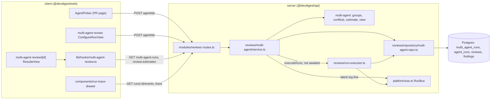
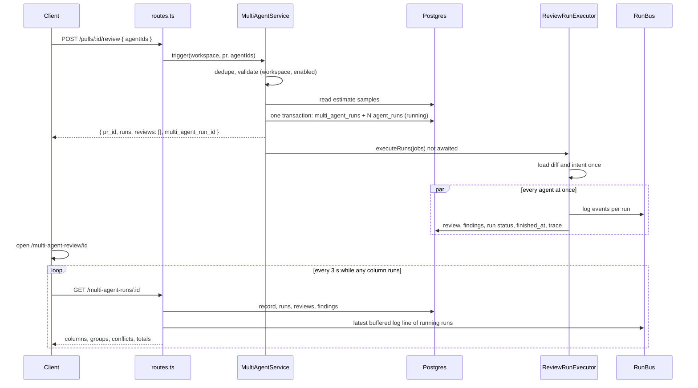
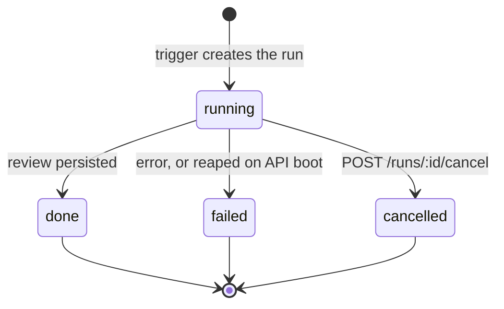

# Multi-Agent Review — several agents on one pull request, with live status

How the studio runs a chosen set of agents on one pull request as a single grouped run, how the
combined result is built, and how the page follows each agent while it works. Read this before
touching `POST /pulls/:id/review` with `agentIds`, the `modules/reviews/multi-agent` folder, the
`multi_agent_runs` table, `AgentPicker`, the `/multi-agent-review` pages, or the 1-agent vs
3-agent measurement.

Requirements: [`specs/multi-agent-review/spec.md`](../specs/multi-agent-review/spec.md)
(SPEC-08). Status: implemented. **AC-50 and AC-51 (the measurement record) are open:** no
measurement has been performed yet; see [Measuring 1 agent vs 3 agents](#measuring-1-agent-vs-3-agents).

## What it does

- A reviewer ticks any set of enabled agents, on the PR page or on a Configure run screen, and
  starts them together. The API creates **one multi-agent run** and **one agent run per distinct
  agent**, all in one transaction, and starts every agent at once.
- The result page `/multi-agent-review/<id>` shows one column (or tab) per agent, each with its own
  live status, duration, cost, score and findings. One agent failing does not stop or hide the others.
- Findings of different agents on the same lines are **grouped** (positionally, with no model call).
  Nothing is deleted or rewritten: every original finding keeps its author and text.
- A **Where agents disagree** block lists every group as a row with one cell per agent, including
  agents that did not flag the location.
- Before a run, the pickers show a **time and cost estimate** from each agent's past runs.
- The old request forms `{ agentId }` and `{ all: true }` keep their shape and create no multi-agent
  record. Their execution is concurrent too, because the executor is shared.

## User flows

### PR page: the agent picker

[`AgentPicker`](../client/src/app/repos/[repoId]/pulls/[number]/_components/AgentPicker/AgentPicker.tsx)
replaced the old "Run all enabled agents / single agent" dropdown in the PR header.

- **Run Review** opens a panel with every enabled agent of the workspace, **none checked**, each with
  a checkbox, its name and its estimated duration (`~12 s`, or `—` without history). Closing the panel
  (Escape, a click outside, or a successful run) clears the selection. Nothing is remembered.
- **Clear** unchecks everything. **Run multi-agent review (N)** is disabled at N = 0 and also while the
  request is in flight (and a guard ref blocks a second activation), so one click starts one run.
- N = 1 is a normal multi-agent run. On success the page opens the result page of the new run.
- No enabled agent: the panel shows the "no enabled agents" message with a link to the Agents page and
  no run button. **Configure agents…** opens the Agents page.
- A merged or closed PR keeps the muted warning and still allows the run.
- A **Latest multi-agent run** link appears in the PR header when the PR has at least one multi-agent run
  (`GET /pulls/:id/multi-agent-runs/latest`, newest by start time) and is absent otherwise. Older runs
  are reachable only by their address.

### Configure run

The sidebar item **Multi-Agent Review** opens
[`/multi-agent-review`](../client/src/app/multi-agent-review/_components/ConfigureRunView/ConfigureRunView.tsx).

1. **Pull request.** A selector lists the **open** PRs (not merged or closed) of the active repository as
   `#<number> · <title>`. Without an active repository, or without open PRs, a message replaces the
   selector. `?pr=<id>` preselects a PR when it is still open. Changing the PR clears the selection. When the picked PR has a multi-agent run, a
   **Latest multi-agent run** card under the selector (with the start time) opens that run's result page;
   it is absent otherwise.
2. **Agents to run.** Until a PR is picked the step reads "Pick a pull request first". Then every
   enabled agent is a card with a checkbox, its estimated duration and cost, "based on N runs", and its
   description (omitted when empty). **Select all** checks every card; none is checked on arrival.
3. **Run multi-agent review (N)** is enabled for a PR and N ≥ 1. Next to it:
   `≈ <time> · <cost> · parallel fan-out`, where time is the largest duration estimate of the checked
   agents and cost is the sum of their cost estimates. Agents missing either estimate are left out of
   that total and counted: "K agents without history not included".

### Result page

[`/multi-agent-review/<id>`](../client/src/app/multi-agent-review/[id]/page.tsx) has its own address;
reloading or returning shows the same run with the current status. An unknown run, or one of another
workspace, shows a "not found" state (the API answers 404).

- **Header.** `#<number> <title>`, "N agents · parallel", **Total time**, **Total cost**, **Configure
  run**, and the **Columns | Tabs** switch (`?view=columns|tabs`, default Columns). The totals read `—`
  until every agent run has ended. After that the header also shows `estimate <value>` next to each
  actual (when the run recorded an estimate). A total cost that includes a run without a cost carries
  "excludes unpriced agents". **Configure run** selects this run's repository and opens Configure run
  with this PR preselected.
- **Columns.** One column per agent run, scrolling horizontally when they do not fit (the scroller is
  focusable, so the keyboard can scroll it). A column shows the agent name, its status as icon **and**
  word, duration and cost once known, the score once `done`, one card per finding (severity, title,
  `file:line`, accepted or dismissed), the finding count, and **View trace**. A `running` column shows
  the elapsed time and the **latest line of that run's log**; the full log lives only in the trace
  drawer. A `failed` or `cancelled` column shows its status and recorded error text in place of findings.
  **Cancel** in a running column cancels that run only.
- **Tabs.** One tab per agent run, labelled with the name and the score, or the status while there is no
  score (arrow keys, Home and End move between tabs). The selected tab shows the agent summary (score,
  review summary, duration, cost, **View trace**) and its findings. Expanding a finding shows confidence
  as a percentage, the rationale, the suggested fix when present, **Accept**, **Dismiss**, **Turn into
  eval case**, and a **Learn** control that is disabled with the accessible description "not available
  yet". There is no "Reply to author".
- **Also flagged by.** In both modes a finding whose group holds findings of other agents shows "also
  flagged by <agent names>".
- **Where agents disagree** (below the columns or tabs, in both modes): see
  [Disagreement rows](#disagreement-rows).
- **Cancel remaining** appears in the header only while at least one run is `running`. It cancels
  every running run and keeps the results of runs that already ended.
- **View trace** opens the existing run trace drawer
  ([`client/src/components/run-trace-drawer`](../client/src/components/run-trace-drawer/RunTraceDrawer.tsx),
  moved there from the PR route so both pages share it). It opens on the live-log tab while the run is
  `running` and on the trace tab otherwise, with the same content as from the PR page (tokens, cost,
  grounding summary, the run log including dropped findings). The trace may be saved a moment after
  the run turns `done`, so the trace request retries a 404 up to 5 times, 1 s apart.
- **Finding actions** go through the existing `POST /findings/:id/(accept|dismiss)`. The decision shows
  in both modes and on the PR page Findings tab. **Turn into eval case**
  ([`EvalCaseButton`](../client/src/components/eval-case-button/EvalCaseButton.tsx), moved to the shared
  `components/`) behaves as in [`eval-pipeline.md`](eval-pipeline.md) and is offered once the finding is
  accepted or dismissed.
- **Learn is disabled by design.** The server accepts only `accept` and `dismiss`
  ([`findings.ts`](../server/src/modules/reviews/findings.ts)); the control is a visible placeholder.

## Where it lives

One box per real module or file:

`modules/reviews` is the existing module; the feature adds the `multi-agent/` folder and
`repository/multi-agent.repo.ts` to it. `ReviewService` builds a `MultiAgentService` with the
repository, the agents repository, the `RunBus` and the shared executor, and delegates to it.
`groups.ts`, `conflicts.ts`, `estimate.ts` and `view.ts` are pure (no I/O); only `multi-agent.repo.ts`
touches Drizzle.

## Data flow

A trigger returns before any agent has finished; the page then reads state from the API.

**Trigger** ([`multi-agent/service.ts`](../server/src/modules/reviews/multi-agent/service.ts)):

1. The ids are de-duplicated (order kept).
2. Everything is validated **before any write**: at least one id; every id names an agent of the
   workspace; no agent is disabled. Otherwise `400 invalid_run_request` and no record, no run.
3. The PR and its repository are looked up (404 when missing).
4. The estimate is computed for the chosen agents ([Estimates](#estimates)) and stored on the record.
5. [`createMultiAgentRun`](../server/src/modules/reviews/repository/multi-agent.repo.ts) inserts the
   `multi_agent_runs` row and one `agent_runs` row per agent (status `running`, `source = local`,
   provider and model as stored at trigger time) in **one transaction**, so a batch is never
   half-created. A later edit of an agent does not change a batch already started.
6. `executeRuns` is started in the background and not awaited; a crash is logged.
7. The response is the usual `{ pr_id, runs: [{ run_id, agent_id, agent_name }], reviews }` plus
   `multi_agent_run_id`. `runs` follows the order of the de-duplicated ids.

**Execution** ([`run-executor.ts`](../server/src/modules/reviews/run-executor.ts)). `executeRuns` loads
the PR diff and resolves the PR intent **once** for the whole batch, then runs every agent
concurrently with `Promise.allSettled` and no parallelism cap. The shared steps are written to every
agent's log (one `RunLogger` fans out over all run ids), so each agent's persisted trace carries
`Diff ready — N changed file(s)…` and `Shared preparation (diff + intent) done (<n>ms)`. Each agent
then passes through the same untrusted-input wrapping, grounding gate, scope filter, citation filter
and persistence as a single-agent run, and counts in the PR's run history and Findings tab. A run that
fails or is cancelled is recorded as `failed` or `cancelled` with its error text and its trace, and the
others continue.

Other triggers (`{ agentId }`, `{ all: true }`, `POST /reviews/:id/rerun`) call the same executor, so
their agents also start together; they create no multi-agent record.

### API

| Endpoint | Purpose |
|---|---|
| `POST /pulls/:id/review` | Trigger. Body `{ agentIds: uuid[] }`, or `{ agentId }`, or `{ all: true }`. `agentIds` cannot be mixed with the others (400). Per-route limit: 10 per minute. |
| `GET /multi-agent-runs/:id` | The read model `MultiAgentRun`. 404 when the run is unknown or belongs to another workspace. |
| `GET /pulls/:id/multi-agent-runs/latest` | `{ latest: { id, ran_at } \| null }` for the PR's newest run. 404 for an unknown PR. |
| `GET /review-estimates` | `{ estimates: AgentEstimate[] }` for every agent of the workspace. |
| `POST /runs/:id/cancel`, `GET /runs/:id/trace`, `GET /runs/:id/events` | Existing; the result page reuses them per agent run. |
| `POST /findings/:id/(accept\|dismiss)` | Existing finding decisions. |

Every multi-agent read and the trigger are scoped to the caller's workspace (all queries filter by it).

## Contracts

Defined in
[`observability.ts`](../server/src/vendor/shared/contracts/observability.ts) (canonical in
`server/src/vendor/shared`; `client/src/vendor/shared` holds an identical copy and the two change
together), with `RunRequest.agentIds` in
[`platform.ts`](../server/src/vendor/shared/contracts/platform.ts) and
`ReviewRunResponse.multi_agent_run_id` (optional) in
[`review-api.ts`](../server/src/vendor/shared/contracts/review-api.ts).

| Contract | Holds |
|---|---|
| `MultiAgentRun` | `id`, `pr_id`, `repo_id`, `pr_number`, `pr_title`, `ran_at`, `agent_count`, `total_duration_ms` (nullable), `total_cost_usd` (nullable), `cost_incomplete`, `estimate` (nullable), `columns`, `groups`, `conflicts` |
| `AgentColumn` | one agent run: `run_id`, `agent_id`/`agent_name` (nullable when the agent was deleted; shown as "Unknown agent"), `provider`, `model`, `status` (`running` \| `done` \| `failed` \| `cancelled`), `error`, `verdict`, `score`, `summary`, `duration_ms`, `tokens_in`, `tokens_out`, `cost_usd`, `started_at`, `latest_log` (only while `running`), `findings` (full `FindingRecord`s) |
| `FindingGroup` | `id` (`<file>:<start>-<end>`), `file`, `start_line`, `end_line`, `title`, `severity` (of the most severe member), `members: { finding_id, run_id }[]` |
| `Conflict` | one disagreement row: `group_id`, `file`, `line`, `title`, `is_conflict`, `takes: ConflictTake[]` |
| `ConflictTake` | one cell: `run_id`, agent id and name, `state` (`flagged` \| `did_not_flag` \| `running` \| `failed` \| `cancelled`), `severity`, `title`, `finding_id`, `more_count`, `agent_summary` |
| `RunEstimate` | stored on the run: `time_ms`, `cost_usd`, `agents_without_time`, `agents_without_cost` |
| `AgentEstimate` | per agent: `agent_id`, `duration_ms`, `cost_usd`, `runs`, `cost_runs` |
| `LatestMultiAgentRun`, `ReviewEstimates` | response wrappers |

The read model is assembled by the pure function
[`buildMultiAgentRun`](../server/src/modules/reviews/multi-agent/view.ts). Columns are ordered by agent
name (case-insensitive, then run id), with columns of deleted agents last; findings inside a column are
sorted by file, start line, end line, id. The groups, rows, titles and order depend only on the stored
findings, so the same data always gives the same result.

## Database

Migration `0016_exotic_ogun.sql` (the `multi_agent_runs` table already existed as an empty stub):

| Table | Column or index | Meaning |
|---|---|---|
| `agent_runs` | `finished_at` timestamptz, nullable | Set when a run reaches a terminal state (completion, failure, cancel, boot reap); null while running and on runs from before the migration. |
| `agent_runs` | `multi_agent_run_id` uuid, nullable, FK to `multi_agent_runs.id`, `ON DELETE SET NULL` | The batch a run belongs to; null for single runs. Index `agent_runs_multi_idx`. |
| `multi_agent_runs` | `estimate` jsonb, nullable | The `RunEstimate` computed at trigger time. Index `multi_agent_runs_pr_ran_idx` on (`pr_id`, `ran_at`). |

`multi_agent_runs` already held `id`, `workspace_id`, `pr_id` (cascade) and `ran_at`. Migrations are not
applied on boot: run `pnpm db:migrate` in `server/`.

## Finding groups

[`groups.ts`](../server/src/modules/reviews/multi-agent/groups.ts) puts two findings of one multi-agent
run in the same group when they are in the **same file** and their **inclusive line ranges**
`[start_line, end_line]` overlap. The relation is transitive (union-find): A overlaps B and B overlaps C
puts all three together. No LLM or embedding is called.

- Two different issues on overlapping lines land in one group. That trade-off is accepted because each
  original finding stays visible.
- Grouping never deletes, merges or rewrites a stored finding. The group only lists its members
  (`finding_id`, `run_id`); the columns keep the originals, with the author, title, severity,
  rationale and suggestion.
- A group's range is the union of its members; its title and severity are those of the most severe
  member (`CRITICAL` > `WARNING` > `SUGGESTION`); on a tie the first member in the order
  (file, start line, end line, id) wins.

## Disagreement rows

[`conflicts.ts`](../server/src/modules/reviews/multi-agent/conflicts.ts) builds one row per group and
one cell per agent run of the multi-agent run:

| Cell state | When | The cell shows |
|---|---|---|
| `flagged` | the agent has at least one finding in the group | severity and title of its most severe finding there, plus "+N more" when it has N further findings in the group |
| `did_not_flag` | the run is `done` and has no finding in the group | "did not flag", and a second line "Agent summary:" with the agent's overall review summary (truncated, full text on hover and focus; omitted when empty). It is the agent's overall summary, not a reason for this location. |
| `running`, `failed`, `cancelled` | the run has no finding in the group and has not finished successfully | the status as icon and word |

A row is a **conflict** (`is_conflict`) when at least one agent flagged the location and at least one
`done` agent did not, **or** the agents that flagged it gave different severities. Cells of `failed`,
`cancelled` and `running` runs never count as silence. **Show only conflicts** (off when the page opens)
keeps only conflict rows. An empty state replaces the rows when there is no group ("No findings to
compare.") or the switch hides every row. While any run is `running`, the block says it is incomplete
and updates as each run ends.

## Estimates

[`estimate.ts`](../server/src/modules/reviews/multi-agent/estimate.ts) and
[`multi-agent.repo.ts`](../server/src/modules/reviews/repository/multi-agent.repo.ts) compute them:

- **Duration** is the median of the agent's last 10 `done` runs that have a recorded duration. **Cost**
  is the median of its last 10 `done` runs that have a recorded cost (the window is applied after runs
  without the value are dropped). Per metric, an even count takes the mean of the two middle values.
- `AgentEstimate.runs` and `cost_runs` count the runs behind each median; the Configure run card shows
  "based on N runs" from `runs`.
- With no qualifying run the estimate is `null` and the pickers show `—`.
- Totals (Configure run, and the estimate stored at trigger time): time is the **maximum** of the known
  durations (the agents run concurrently) and cost is the **sum** of the known costs. Agents without a
  value are left out and counted (`agents_without_time`, `agents_without_cost`).
- The estimate excludes the shared diff and intent preparation, while the actual total time is
  wall-clock, so the actual total is usually above the estimate by about that preparation time.

## Live status, totals and cancel

The page does not hold a stream per agent. `useMultiAgentRun` polls `GET /multi-agent-runs/:id` every
3 seconds **while any column is `running`** and stops when none is, keeping the last good data across a
transient error. This keeps a status change visible well within 5 seconds, and survives reloads
and navigation, because the status comes from the API. While a run is `running`, the response carries
the last buffered log line of that run from the in-memory `RunBus`; the full log streams over SSE only
inside the trace drawer.

- **Total time** (`total_duration_ms`) is `null` while any run is `running`; afterwards it is the
  wall-clock time from the creation of the multi-agent record to the latest `finished_at`. It therefore
  includes the shared preparation, unlike each run's own `duration_ms`, which starts after it.
- **Total cost** (`total_cost_usd`) is the sum of the non-null run costs, `null` when no run has one.
  `cost_incomplete` is true when **any** run has no cost, including failed and cancelled runs, not only
  unpriced models; the header then shows "excludes unpriced agents".
- **Cancel** in a column and **Cancel remaining** call the existing `POST /runs/:id/cancel` for the run(s)
  and then refetch. Results of runs that already ended are kept.

## Degraded modes

| Situation | Behaviour |
|---|---|
| One agent fails (missing provider key, LLM error, timeout) | That run is `failed` with its error text and trace; the other runs complete. Its column shows the error; its cells in the disagreement block read "failed" and are ignored when deciding a conflict. |
| Every agent fails | Every column shows `failed`; every cell reads "failed"; total cost is `—`. |
| The shared diff load fails | Every run of the batch is `failed` with the same error text (`Failed to load PR diff: …`). See also the limitation on the fallback below. |
| Intent derivation fails or no key | Never fails a run: the batch continues with no intent. |
| An agent has no history, or only unpriced runs | `—` for the missing estimate; excluded from the matching total and counted in "K agents without history not included". |
| Unpriced or failed agents in the cost total | The total sums the known costs and is marked "excludes unpriced agents". |
| An agent is deleted after the run | The column keeps the run, with the agent name shown as "Unknown agent". |
| An agent is disabled between opening the picker and starting | `400` naming the agent; nothing is created. |
| An agent is edited between opening the picker and starting | The batch runs with the agent as stored at trigger time. |
| The API restarts during a run | In-flight runs are reaped as `failed` on boot, and the page shows them as such. |
| A provider rate-limits some agents when they start together | Each limited run fails on its own; the others complete. |
| The PR gets new commits after the run | The page keeps showing the run as recorded. |
| Another review runs on the same PR | The new trigger is accepted and runs alongside it. |
| Latest-run link request fails | The PR page shows no link. |

## Untrusted text and security

- Finding text, PR titles, review summaries (including the "Agent summary:" line), error text and log
  lines (including the latest line in a column) can quote PR or model text. The feature renders them as
  plain React text nodes. Finding rationale and suggestion go through the existing Markdown renderer
  (`react-markdown`, no raw HTML). Nothing is executed, and nothing is fed back to a model by this feature.
- The agent id set is validated against the caller's workspace before any record is created.
- PR diff and PR body reach each agent only through the existing engine wrapping; the feature adds no
  prompt path and does not change the grounding gate or the scope filter.
- The per-route rate limit of `POST /pulls/:id/review` (10 per minute) is unchanged.

## Measuring 1 agent vs 3 agents

**Status: not measured.** No 1-agent or 3-agent measurement has been performed. This section describes
how to take it and what the product already records. The result will be added here, as a measurement
record, after real runs; until then AC-50 and AC-51 stay open.

Nothing in this page predicts a ratio. The 3-agent / 1-agent ratio must not be fitted to an expected
3×: provider-side caching, the shared diff and intent preparation, and different answer lengths can each
move it, and the record states whatever the runs show.

### What the product already records

| Needed for the record | Where it is stored |
|---|---|
| Date | `ran_at` of the multi-agent run (`GET /multi-agent-runs/:id`); `started_at` per column |
| Provider and model per agent | `provider`, `model` per column (copied from the agent at trigger time) |
| Wall-clock time from trigger to the end of the last agent | `total_duration_ms` of the multi-agent run (record creation to the latest `finished_at`) |
| Duration, tokens in, tokens out, cost of each agent run | `duration_ms`, `tokens_in`, `tokens_out`, `cost_usd` per column, and the same figures in the run's trace (`stats`) |
| Duration of the shared diff and intent preparation | the log line `Shared preparation (diff + intent) done (<n>ms)` in each agent's trace (`GET /runs/:id/trace`, `log`) |
| Run ids | the multi-agent run id and `run_id` per column |
| Which intent path was used | the trace lines `Intent: using stored intent …` or `Intent: none stored — deriving (best-effort)` |
| Changed-file count of the diff | the trace line `Diff ready — N changed file(s) …` |

The product does **not** record the PR head commit on a run, nor cache-read tokens (the trace has no
such field). The measurer notes the head commit, and any cause that depends on caching cannot be cited
as a recorded number.

### Procedure

1. Choose one PR and three enabled agents; pick one of them as the single agent (A; the others B and C).
   Write down the PR's head commit (shown on the PR page and on GitHub) and the date.
2. Make sure the PR already has a stored intent (for example by deriving it on the PR Overview), so that
   both runs take the same path. A run on a PR with no stored intent derives it inside the shared
   preparation; the tokens and cost of that derivation are stored on the PR intent record, not on any
   agent run, and the first run would carry the extra preparation time.
3. Start the **1-agent run**: in the PR picker tick only A and activate "Run multi-agent review (1)".
   Wait until the result page shows every run ended. Note the multi-agent run id.
4. Start the **3-agent run** on the same PR without syncing or refreshing the PR in between: tick A, B
   and C and activate "Run multi-agent review (3)". Wait for the end and note the id. Note which of the
   two runs went first.
5. Confirm that the head commit is still the one written down.
6. For each multi-agent run, copy from `GET /multi-agent-runs/:id` the fields in the table above. For
   each agent run, open `GET /runs/:id/trace` and copy `stats` and the shared-preparation, intent and
   diff lines. Every number in the record is copied from these sources, with its run id, so it can be
   checked against the stored runs and traces.
7. Compute, from the copied numbers only:
   - wall-clock ratio = `total_duration_ms` (3 agents) / `total_duration_ms` (1 agent);
   - cost ratio = `total_cost_usd` (3 agents) / `total_cost_usd` (1 agent). When `cost_incomplete` is
     true for either run, state that the total excludes a run without a cost;
   - token ratio = (sum of `tokens_in` + `tokens_out` over the 3 runs) / (`tokens_in` + `tokens_out`
     of the 1 run).
8. For every factor the record names as a cause of a ratio, cite the number or trace line that shows it,
   for example:
   - different response lengths: `tokens_out` of each run;
   - shared preparation: the `Shared preparation … (<n>ms)` line of each run and the `Intent:` line;
   - concurrency: `total_duration_ms` against the shared-preparation time plus the longest `duration_ms`;
   - caching: not recorded; name it only as an unmeasured possibility, never as a cited cause.
   A factor without a citable number is left out.

The record that results holds, for both runs: the date, provider and model per agent, the wall-clock
time, per-run duration, tokens in, tokens out and cost, the preparation duration, the run ids, the
head commit, and then the three ratios with their cited causes. It is added to this section when the
runs exist.

## Known limitations

These are the behaviours of the current code, not goals.

1. **A cancelled single-pass run can end as `done`.** `ReviewService.cancelRun` marks the run's flag on
   the `RunBus`, marks the row `cancelled` and then calls `RunBus.complete()`, which clears the flag
   ([`sse.ts`](../server/src/platform/sse.ts)). The executor passes `checkCancelled`
   ([`run-executor.ts`](../server/src/modules/reviews/run-executor.ts) around line 254) and
   reviewer-core calls it once per chunk, **before** that chunk's model call
   (`reviewer-core/src/review/run.ts`). Single-pass has one chunk, so a cancel that arrives during the
   model call is never seen; for map-reduce the flag is visible only to a checkpoint that happens inside
   the short window before `complete()`. The run then finishes, and `completeAgentRun` overwrites the
   status with `done` and stores the review. The result page shows the column as `cancelled` after the
   cancel, stops polling once no column is `running`, and shows the later `done` on the next load. This
   is existing behaviour that SPEC-08 did not change.
2. **A `git.diff` failure does not fail the batch by itself.** `loadDiff`
   ([`diff-loader.ts`](../server/src/modules/reviews/diff-loader.ts)) swallows an error from `git.diff`
   (and an empty result) and falls back to the stored `pr_files` patches. A batch fails on diff load only
   when that fallback also throws, for example when reading `pr_files` fails; an empty fallback gives an
   empty diff, not an error.
3. **A malformed agent id gives 422, other bad sets give 400.** An id that is not a uuid is rejected
   by the `RunRequest` schema with `422`; an empty set, an unknown id, another workspace's agent and a
   disabled agent give `400 invalid_run_request`.
4. **Two routes are not workspace-scoped.** `GET /runs/:id/trace` and `POST /runs/:id/cancel`
   authenticate the caller but look the run up by id alone (existing behaviour). The multi-agent reads
   and the trigger are scoped.
5. **No idempotency on the trigger.** The pickers block a double activation while the request is in
   flight, but the API has no idempotency key: two `POST`s with `agentIds` create two batches (the
   rate limit of 10 per minute still applies).
6. **The "excludes unpriced agents" marker also covers failed and cancelled runs**, because it follows
   "any run without a cost".
7. **The latest log line is in memory.** It comes from the `RunBus` buffer of the running process; it is
   gone after a restart (the runs are then reaped as `failed` anyway).
