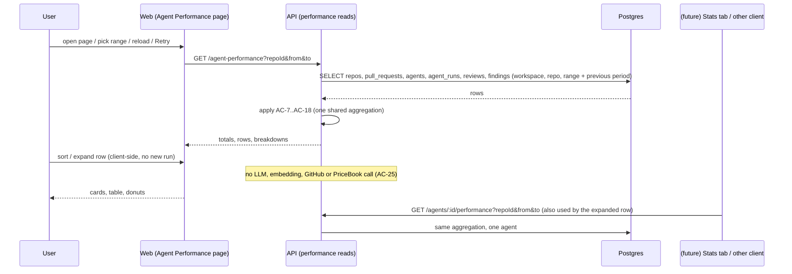

# Design review: Agent Performance Dashboard (SPEC-10)
Sources: specs/agent-performance-dashboard/designs/1-agent-performance-dashboard.webp ·
Current code read: server/src/db/schema/runs.ts:22-85, server/src/db/schema/reviews.ts:9-51,
server/src/db/schema/agents.ts:10-37, server/src/modules/reviews/repository/review.repo.ts:144-168,
server/src/modules/reviews/repository/run.repo.ts:105-112, server/src/modules/reviews/repository/run.repo.ts:128-139,
server/src/modules/reviews/repository/multi-agent.repo.ts:56-72, server/src/modules/reviews/multi-agent/view.ts:95-107,
server/src/modules/reviews/run-executor.ts:564, server/src/modules/ci/collector.ts:206-243,
server/src/modules/ci/repository.ts:199-221, server/src/platform/price-book.ts:21-73,
server/src/platform/container.ts:469-517, reviewer-core/src/llm/openrouter.ts:104-117,
reviewer-core/src/review/run.ts:173-198, server/src/vendor/shared/contracts/trace.ts:71-147,
server/src/modules/eval/service.ts:279, server/src/modules/eval/routes.ts:50-51,
client/src/vendor/ui/nav.ts:21-50, client/src/app/agents/[id]/_components/AgentEditor/constants.ts:11-17,
client/src/app/eval/_components/AgentEvalView/constants.ts:1-11, server/INSIGHTS.md (2026-10-12 cancel,
2026-09-24 ORDER BY), client/INSIGHTS.md (2026-10-04 value imports, 2026-09-25 relativeTime)

## Premise check
- There is no "Stats" tab in the agent editor (constants.ts:11-17 lists Config, Skills, Context,
  Evals, CI), no per-agent metrics read and no aggregation rules in the code. Per the user's decision
  the spec defines the rules (AC-7..AC-18) and two reads (AC-19, AC-20); the tab is NG-1.
- The sidebar GLOBAL group today holds only "CI Runs" (nav.ts:46-49). "Multi-Agent Review" is in
  WORKSPACE (nav.ts:28) and there is no "Memory" item. The design shows Memory, Multi-Agent Review,
  Agent Performance, CI Runs under GLOBAL → Q-14, NG-5.

## States coverage
| Screen / flow | State | In design? | Spec reference |
|---|---|---|---|
| Page | populated, 30 days | yes | AC-2..AC-4, AC-26..AC-38 |
| Page | 1 day / custom range | button only, no picker | AC-3..AC-6, Q-6 |
| Page | loading | no | AC-40 |
| Page | error | no | AC-41 |
| Page | no runs in range | no | AC-42 |
| Page | no agents in workspace | no | AC-43 |
| Page | no repository in workspace | no | AC-63 |
| Page | invalid address part | no | AC-64 |
| Page | repository switched | no | AC-62 |
| Table row | agent with 0 runs in range | no | AC-44, Q-11 |
| Table row | accept rate with small sample | no | AC-14, AC-32, Q-4 |
| Table row | no decisions / unpriced / no duration | no | AC-31 |
| Table row | expanded (loaded / loading / error) | no | AC-35, AC-60 |
| Table row | disabled agent | no | AC-55, AC-30 |
| Total cost card | previous period empty | no | AC-57 |
| Total cost card | estimate vs provider-reported | no | AC-27, Q-5 |
| Total cost card | some runs unpriced | no | AC-27, Q-7 |
| Total cost card | delta vs previous period | yes (-$1.20) | AC-57 |
| Total runs card | sparkline | yes | AC-26, AC-56, Q-24 |
| Avg accept card | no decisions | no | AC-28 |
| Most-active card | no runs / tie | no | AC-17, AC-29, Q-9 |
| Cost breakdown | no priced runs | no | AC-39 |
| Cost breakdown | many slices | no | EC-17, P-5 |
| Sort | Accept ascending/descending | arrow only | AC-33, AC-34 |

## Gaps in the designs
- No definition of a "run" (statuses, sources, running runs) → Q-1, Q-2
- Accept rate shown without denominator; "Avg accept rate" has no formula → AC-13, AC-28, AC-32, Q-3, Q-8
- No small-sample marker or rule → Q-4
- Range button shows "30 days" only; no 1-day choice or custom picker; no boundary rule → Q-6
- Total cost gives no hint whether it is billed or estimated. The data cannot tell today: the run
  stores one `cost_usd`, which is `usage.cost` when OpenRouter reports it and a PriceBook estimate
  otherwise (openrouter.ts:107-117); the source is not stored. A map-reduce run sums several calls
  (run.ts:198) and can mix both. OpenAI/Anthropic runs only ever get estimates. CI runs take
  `cost_usd` from the CI artifact (collector.ts:214). Nothing reconciles with provider invoices →
  Q-5 (research)
- Delta "-$1.20" and the sparkline need a previous-period read; the per-agent ↑/↓ arrows next to
  Accept imply a trend too → Q-13
- Accept colours (green 78%/64%, amber 41%) have no threshold → Q-19
- Agent icons and colours in table and Most-active card: agents have no icon or colour field
  (agents.ts:10-37) → Q-19
- "View" target and row expansion are not shown → Q-17, Q-12
- "Last run" scope (inside the range or ever) → Q-16
- Runs of deleted agents (`agent_id` set null, runs.ts:29) and runs without a model → Q-10
- No loading / error / empty states → AC-40..AC-44

## Edge cases not covered
- Cancelled run that still ends `done` (server INSIGHTS 2026-10-12) → EC-9
- Runs reaped as `failed` at boot (run.repo.ts:105-112) → EC-10
- Failed local runs store `cost_usd = null` (run-executor.ts:564); failed CI runs store null cost,
  model and duration (collector.ts:229-243) → EC-6, EC-7, Q-1
- Accept and dismiss are mutually exclusive and can be undone to "undecided" (review.repo.ts:144-168)
  → EC-15
- Eval suite runs live in a separate table and cost money; brief/intent/conventions/onboarding calls
  have no agent → EC-22, Q-15
- Rounding of legend amounts vs total → EC-18
- Long names, many slices → EC-19, EC-17
- Rapid range switching (out-of-order responses) → EC-23

## Module interactions
| From | To | Via (external contract) | New / changed / existing | Consumers affected |
|---|---|---|---|---|
| Web: Agent Performance page | API | `GET /agent-performance?repoId=&from=&to=` | new | web only |
| Web: expanded row; (future) agent Stats tab, MCP | API | `GET /agents/:id/performance?repoId=&from=&to=` | new | expanded row; parity with the all-agents read (AC-21) |
| API | Postgres | read of `repos`, `pull_requests`, `agents`, `agent_runs`, `reviews`, `findings` | existing tables, read-only | none |
| API ↔ Web | shared contract | new response schemas in `@devdigest/shared` | new | server canonical copy + client copy |
| Web sidebar | — | `client/src/vendor/ui/nav.ts` entry | changed (one entry, owner-approved exception) | every page's sidebar |
| review engine → API → DB (Q-5) | — | cost source recorded per run (AC-45); CI per Q-21 | changed persisted data | CI Runs, PR run history, multi-agent view (none change, NG-7) |

Notes for the implementation planner (internal wiring, not part of the spec):
- One aggregation function feeding both routes is the way AC-21 is guaranteed; test parity
  (every agent row of the global read equals the per-agent read) in an `*.it.test.ts`.
- Do not call `PriceBook.estimate` from the reads: it triggers an OpenRouter `/models` fetch
  (price-book.ts:34-39, 59-72) — that would break AC-25.
- Findings link to runs through `reviews.run_id` (reviews.ts:19); older reviews may have no run id.
  Decide in the plan how such findings are attributed after Q-3.
- `findings.kind` has `finding` and `lethal_trifecta`; both carry decisions.
- Precedent for null costs: the multi-agent view sums non-null costs and flags incompleteness
  (view.ts:95-107); precedent for periods: Eval dashboard `days` = rolling now − N×24 h
  (eval/service.ts:279, AgentEvalView/constants.ts).
- The client may import only types from `@devdigest/shared` (client INSIGHTS 2026-10-04); pass a
  `now` to relative-time formatting for "Last run" (client INSIGHTS 2026-09-25).
- Any list returned needs a total ORDER BY (server INSIGHTS 2026-09-24) for NFR-4.
- AC-45 (cost source): today the provider result carries only `costUsd` (openrouter.ts:117) and
  reviewer-core sums calls (run.ts:198), so the per-call "provider vs estimate" fact is lost before the
  run is completed. The engine result must surface it (still no I/O in reviewer-core), the run row
  needs a new nullable column (drizzle-kit migration; existing rows → `unknown` only for rows that
  have a cost), and `completeAgentRun` (run.repo.ts:142-172) stores it. OpenAI/Anthropic providers
  only ever estimate. The CI collector path depends on Q-21.
- AC-5/AC-24: the page computes instants in the browser time zone; the API never guesses a time zone.
- Repository scope (AC-65): local runs reach a repository only through `agent_runs.pr_id →
  pull_requests.repo_id` (runs.ts:30, pulls.ts:12-14); `pr_id` is set null when a PR goes, so such
  runs drop out. CI runs carry only the text `agent_runs.repo` (runs.ts:58, ci.ts:20) and must be
  matched to `repos.full_name` (repos.ts:14); there is no foreign key. The design's sidebar repo
  switcher is the source of the active repository; the item sits in GLOBAL but its href needs the
  `:repoId` token that `resolveHref` already fills (nav.ts:85-89).
- Index needs change with repo scoping: the range query joins `agent_runs` to `pull_requests` for
  local runs and filters `agent_runs.repo` for CI runs.
- Range-sized queries over `agent_runs` will want an index on (workspace_id, ran_at); today only a
  CI-only partial index exists (runs.ts:80-82).

## UX improvements
- P-1 Keep range, sort and expanded row in the page address — reload and shared links reopen the same
  view — cost S — status: accepted → AC-47 (opens Q-22)
- P-2 Show each slice's share in % next to its amount in both legends — reading a donut needs it —
  cost S — status: accepted → AC-38
- P-3 Add a "Failed" count per agent (failed runs / runs) — failed runs are invisible in the design
  yet cost time — cost S — status: accepted → AC-9, AC-30
- P-4 Show "Data as of <time>" with a Refresh control — the page does not update live (NG-3) — cost S
  — status: accepted → AC-50
- P-5 Group slices beyond the top 6 into "Other" in both donuts, listed in full in the legend —
  colours stop being distinguishable with many agents/models (EC-17) — cost S — status: accepted →
  AC-51
- P-6 Make Runs, Avg cost, Avg dur. and Last run sortable too — the design shows only Accept —
  cost S — status: accepted → AC-52
- P-7 Add a "Cost per accepted finding" column (agent's priced cost / its accepted findings, "—" when
  none) — accept rate alone hides that a cheap agent with 60% may beat an expensive one with 78% —
  cost S — status: accepted → AC-30, AC-58
- P-8 Show the share of the selected period's cost that is provider-reported as a percentage next
  to the Total cost lines — tells at a glance how much of the total is an estimate (Q-5) — cost S —
  status: accepted → AC-27
- P-9 Activating the Most-active agent card scrolls to and expands that agent's row — the card is a
  natural entry point and today leads nowhere — cost S — status: accepted → AC-67

## Decisions log
- Round 0 (caller, before drafting): no Stats tab exists; build one shared server-side aggregation
  exposed as a global read and a per-agent read; the "matches Stats" criterion is checked against the
  per-agent read; no Stats tab in the agent editor (NG-1).
- Round 1: Q-1 → all ended runs (done, failed, cancelled) counted; averages from `done` only (AC-7,
  AC-9, AC-11, AC-12). Q-2 → CI runs counted; accept rate from local runs only (AC-7, AC-13, AC-28,
  AC-32). Q-3 → findings of counted runs, decision as stored at read time (AC-13). Q-4 → minimum 10
  decisions; low sample labelled and sorted after qualified rows in both directions (AC-14, AC-34).
  Q-5 → record cost source per run from now on (AC-45, AC-27, NG-2, NG-6, NG-7; opens Q-21 for CI).
  Q-6 → rolling presets; custom range in whole local calendar days, max 366 days (AC-5, AC-6, AC-24).
  Q-7 → sum priced runs, show "K runs not priced" (AC-10, AC-11, AC-27). Q-8 → pooled avg accept
  rate (AC-15). P-1 accepted → AC-47 (opens Q-22); P-2 → AC-38; P-3 → AC-9, AC-30; P-4 → AC-50;
  P-5 → AC-51; P-6 → AC-52. New in round 2: P-7, P-8.
- Round 2: Q-9 → latest Last run, then name (AC-17). Q-10 → in totals as "Deleted agent" / "Unknown
  model" slices, no table row, never most-active (AC-53, AC-54; opens Q-23). Q-11 → enabled agents
  plus disabled agents with runs in range, labelled "Disabled" (AC-55, AC-30). Q-12 → expanded row
  shows per-agent breakdowns from the per-agent read (AC-35, AC-20, AC-60). Q-13 → sparkline and
  cost delta vs previous period, no per-agent arrows (AC-26, AC-56, AC-57, NG-8; opens Q-24).
  Q-15 → agent review runs only (NG-9, AC-59). Q-16 → Last run = latest ended run ever (AC-16).
  Q-17 → "View" opens `/agents/:id` (AC-36). P-7 accepted → AC-30, AC-58 (opens Q-25);
  P-8 accepted → AC-27. Q-19 split: icons moved to Q-26.
- Round 3: Q-14 → add only Agent Performance to GLOBAL; Multi-Agent Review stays (AC-1, NG-5).
  Q-18 → active repository only (not the recommended option): every number, both reads (`repoId`
  required), Last run, previous period, empty states and the page address are scoped to one
  repository; the page names it (AC-61..AC-65, AC-7, AC-16, AC-19..AC-24, AC-42, AC-47, NG-10;
  EC-35..EC-40). Q-19 → thresholds 70 / 50, low sample neutral, text description (AC-68). Q-21 →
  CI runs keep `unknown` cost source, no CI change (AC-45, NG-11). Q-22 → reset only the invalid
  part with a notice (AC-64). Q-23 → deleted agents' findings count in Avg accept rate (AC-15,
  AC-53). Q-24 → equal buckets from `from` (AC-56). Q-25 → local priced runs / accepted (AC-58).
  P-9 accepted → AC-67. Q-20, Q-26 and new Q-27 (case of CI `owner/name` match) stay non-blocking
  with defaults noted in the spec.
- Approval: user approved; no blocking question left → Status: approved.
