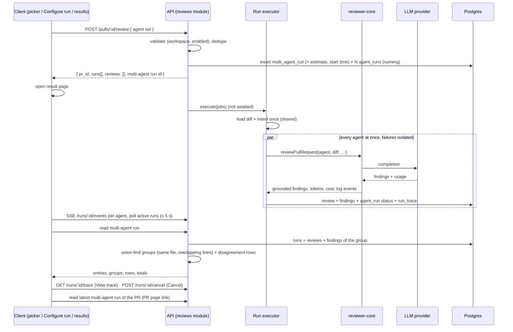

# Design review: Multi-Agent Review with live per-agent status (SPEC-08)
Sources: designs/01-pr-page-agent-picker.png, 02-configure-run-empty.png, 03-configure-run-selected.png,
04-results-columns.png, 05-results-tabs-detail.png; reference codebase
inbox/dev-digest-lesson-7-lab-multiagents-finish (data only) · Current code read:
server/src/modules/reviews/routes.ts:28-45, :115-127, :160-166;
server/src/modules/reviews/service.ts:47-58, :97-135, :148-183;
server/src/modules/reviews/run-executor.ts:65-150 (sequential loop at :122), :291-341;
server/src/modules/reviews/findings.ts:30-43; server/src/db/schema/runs.ts:8-56;
server/src/vendor/shared/contracts/observability.ts:22-86; contracts/platform.ts:275-279;
contracts/review-api.ts:45-57; contracts/findings.ts:52-97; contracts/trace.ts:126-148;
server/specs/review-flow.md; reviewer-core/src/review/run.ts:205-237;
client/src/app/repos/[repoId]/pulls/[number]/page.tsx:49-87, :97-104, :233-241;
…/_components/RunReviewDropdown/RunReviewDropdown.tsx:41-121; …/_components/FindingCard/FindingCard.tsx:85-135;
…/_components/RunTraceDrawer/RunTraceDrawer.tsx:41-102; client/src/lib/hooks/reviews.ts:28-47, :124-171;
client/src/vendor/ui/nav.ts:21-45; mcp/src/api/client.ts:95

## States coverage
| Screen / flow | State | In design? | Spec reference |
|---|---|---|---|
| PR picker | opened, none checked (default) | no — the design shows agents pre-checked; overridden by Q-19 | AC-1, AC-3 |
| PR picker | some checked | yes (01) | AC-2 |
| PR picker | no enabled agents / no agents | no | AC-6 |
| PR picker | agent without history (estimate) | no | AC-16 |
| PR picker | trigger in flight / error (e.g. disabled agent) | no | AC-18, AC-20 |
| PR picker | merged / closed PR | no (exists today) | AC-8 |
| PR page | has / has no multi-agent run | no | AC-59 |
| Configure run | no active repo / no open PRs | no | AC-58 |
| Configure run | no PR selected | yes (02) | AC-11. The design shows the run button enabled with "(4)", a contradiction. |
| Configure run | PR selected, none checked (default) | no — the design shows 4 of 5 pre-checked; overridden by Q-19 | AC-12, AC-14 |
| Configure run | PR selected, some checked | yes (03) | AC-13, AC-14, AC-53 |
| Configure run | some checked agents without history | no | AC-16, AC-53 |
| Configure run | agent with empty description | no | AC-12 |
| Results | all done | yes (04, 05) | AC-31, AC-37, AC-56 |
| Results | running (live) | no | AC-32, AC-54, AC-55 |
| Results | one agent failed / cancelled | no | AC-34, AC-45 |
| Results | all failed / diff load failed | no | EC-6, AC-24 |
| Results | loading / not found | no | EC-21 |
| Results | agent with 0 findings | no | EC-10 |
| Results | more columns than fit | no | AC-60 |
| Disagree block | rows present | yes | AC-45 |
| Disagree block | one agent with several findings in a row | no | AC-45 ("+N more") |
| Disagree block | no rows / filter hides all | no | AC-47 |
| Disagree block | incomplete while running | no | AC-48 |
| Tabs | finding expanded with actions | yes (05) | AC-39 |
| Tabs | finding accepted / dismissed | no | AC-40 |
| Columns / Tabs | finding also flagged by others | no | AC-57 |
| Trace | opened from column / tab | link only | AC-35, AC-36 |

## Gaps in the designs
- No view shows grouped findings. In Columns, the same "Retry-After header omitted on 429" at
  `ratelimit.ts:52` appears under both Security and Customer-Facing → resolved by Q-4: AC-44, AC-57.
- The disagree block contradicts the columns:
  - Security is shown as "did not flag" at `ratelimit.ts:52`, but its column lists a finding there.
  - Architecture appears in both rows, but it was not selected to run.
  → AC-45: cells only for agents of the run, verdict taken from data. Failed or cancelled agents get
  their own cell (Q-14).
- The "did not flag" cells carry location-specific explanations ("Not a security concern.") that no
  data source provides → resolved by Q-11. The cell shows the agent's overall review summary on one
  line, under an explicit "Agent summary:" label, so it is not read as a reason for this location
  (AC-45).
- The Configure-run cards show PR-specific verdicts ("Two critical exposures…") before any run →
  resolved by Q-15: the agent description, omitted when empty (AC-12).
- The empty Configure-run screen shows an enabled-looking "Run multi-agent review (4)" with no PR
  selected → AC-11.
- **Pre-checked agents in the mock-ups (01: both checked; 03: 4 of 5 checked; 02: "(4)") are
  overridden by the user's decision Q-19.** Both screens open with no agent checked (AC-1, AC-12,
  NG-5). The "(N)" count starts at 0, and the button is disabled until the user checks an agent.
- No running, failed or cancelled column state, and no place for the live log → AC-32..AC-34, AC-54,
  AC-55. The live log stays in the drawer, and the column shows the latest line only (Q-21).
- "Learn" has no backend (`findings.ts:41` rejects it), and "Reply to author" is not in the task →
  resolved by Q-7: AC-39, NG-7.
- The header says "fan-out via worktrees". Execution is in-process, against one shared diff → NG-6,
  AC-28.
- Estimates: "≈ 8.2s · $0.20" is the maximum of times and the sum of costs. Concurrent execution makes
  this valid (Q-2, AC-21). The estimate excludes the shared preparation, while the actual total time
  (Q-10) includes it → EC-24, AC-56.
- No way back to a past result: the sidebar opens Configure run (Q-12) → resolved by Q-25: the PR page
  links to the PR's latest multi-agent run (AC-59). Older runs are reachable by address only.
- "Configure agents…" had no defined target → resolved by Q-13: the Agents page (AC-7).
- No stop control while agents run → AC-54, AC-55.
- Four or more columns of fixed width: the designs show no overflow behaviour → resolved by Q-26:
  horizontal scroll (AC-60).
- The mock-up sidebar shows Memory, Agent Performance and CI Runs, which are out of scope → NG-3.

## Edge cases not covered
- Double submit → EC-3
- One or all agents fail, diff load fails, API restart mid-run → EC-5..EC-9
- Concurrent provider rate limits after parallel start → EC-23
- Agent with zero findings, same agent twice in one group → EC-10, EC-11
- Different severities at one place, different issues on overlapping lines → EC-12, EC-13
- Many agents, long titles, paths and summaries → EC-14, EC-15
- New commits after the run, concurrent run on the same PR → EC-16, EC-17
- Agent deleted / disabled / edited around the run → EC-18, EC-19
- Decision made elsewhere while the page is open → EC-20
- Deep link to another workspace's run → EC-21
- Trace not yet persisted when the run turns done → EC-22
- Actual time above the estimate because of the shared preparation → EC-24
- Returning to a past result → EC-25

## Module interactions
| From | To | Via (external contract) | New / changed / existing | Consumers affected |
|---|---|---|---|---|
| client picker / Configure run | API | `POST /pulls/:id/review`: new optional agent-id set (deduplicated; a disabled agent → 400 naming it); response gains the multi-agent run id | changed (additive) | client `useRunReview`; MCP `devdigest_run_review` (`mcp/src/api/client.ts:95`) keeps `{agentId}` / `{all}` unchanged (AC-52) |
| client results page | API | read of one multi-agent run (entries incl. summary and latest log line, groups, disagreement rows, wall-clock total, recorded estimate) | new. The `MultiAgentRun` / `AgentColumn` / `Conflict` shapes exist unused in `observability.ts` and need extension (status `cancelled`, tokens, error, full findings, groups, estimate, `failed`/`cancelled` cells, "+N more" count). | client only; both vendor copies of `@devdigest/shared` |
| client PR page | API | read of a PR's latest multi-agent run (absent when none) | new | client only |
| client Configure run | API | open PRs of the active repository | existing PR list (filtering per AC-10) | — |
| client picker / Configure run | API | per-agent estimates (median of last 10 done runs, run count) via the agent list or a new read | changed or new (planner's choice of carrier) | Agents page, MCP `devdigest_list_agents` if the agent list is extended |
| client | API | `GET /runs/:id/events` (SSE), `GET /runs/:id/trace`, `GET /pulls/:id/runs/active`, `POST /runs/:id/cancel` | existing | — |
| client | API | `POST /findings/:id/accept|dismiss`, `POST /findings/:id/eval-case` | existing | — |
| API | run executor → reviewer-core → LLM provider | in-process call per agent | existing; becomes concurrent for every batch (AC-21) | every review trigger, incl. "all", MCP, rerun |
| API | Postgres | `multi_agent_runs` + link from `agent_runs` + recorded estimate + record creation time as the start of the wall-clock total (persisted data) | changed (stub table gains a link; new migration) | run history reads |

Notes for the implementation planner (internal wiring, not part of the spec):
- `run-executor.ts:122` runs agents sequentially. AC-21 makes every batch concurrent, which changes
  `server/specs/review-flow.md` ("Isolation between agents"). Failure isolation is already inside
  `runOneAgent`. A settle-all style keeps it.
- `RunLogger` is already fanned out over all run ids (`:75-80`), so the shared diff/intent lines
  already land in every agent's log. The latest log line per run (AC-32) is available from the run
  bus buffer or the SSE stream.
- Per-agent `durationMs` starts after the shared preparation (`:123`, `:163`). The wall-clock total
  (AC-26) is measured from the multi-agent record's creation.
- `multi_agent_runs` (`runs.ts:47-56`) has no link from `agent_runs`. It also needs a place for the
  recorded estimate (AC-56). A migration is needed: run drizzle-kit generate. Per INSIGHTS, its rename
  prompt hangs without a TTY.
- `RunRequest` (`platform.ts:275`) gains an optional id array. Mind null versus absent bodies (server
  INSIGHTS 2026-10-09). Today `{agentId}` does not check `enabled` (`service.ts:52-55`). AC-20 checks
  it for the agent set only.
- The `observability.ts` contracts are unused and lack `cancelled`, tokens, error and full finding
  records. Changing them means syncing `server/src/vendor/shared` → `client/src/vendor/shared`.
- `RunTraceDrawer` lives under the PR route (`…/pulls/[number]/_components/RunTraceDrawer`) and is opened
  via `?trace=`. Reusing it from the new page means moving it to a shared place. `LiveLogStream` is in
  `client/src/vendor/ui`: use it as is, do not edit it.
- The client may import only types from `@devdigest/shared` (client INSIGHTS 2026-10-04).
- The sidebar entry goes into `client/src/vendor/ui/nav.ts` (owner-approved exception) and points at
  Configure run.
- Reference grouping: `inbox/…/server/src/modules/reviews/multi-agent-conflicts.ts`. It uses union-find
  over same-file, overlapping inclusive ranges, with a severity-first representative title. It differs
  from AC-45 in three ways: failed and cancelled agents get their own cell; "+N more" is added; the
  "did not flag" note becomes the agent's summary.
- The 5 s status bound (NFR-1) matches the existing 4 s active-run polling (`hooks/reviews.ts:33`).
- Server tests that hit the DB must end `*.it.test.ts`. A test that asserts on a trace must poll the
  trace endpoint (server INSIGHTS 2026-09-24).
- `docs/multi-agent-review.md` is a new document (AC-50). Proposal: add a CLAUDE.md "Read When" row
  for it.

## UX improvements
- P-1 Per-agent Cancel in a running column + "Cancel remaining" in the header — reuses the existing cancel route; the designs have no stop control — cost M — status: accepted → AC-54, AC-55
- P-2 Retry a failed agent inside the same multi-agent run — cost M — status: rejected → NG-8
- P-3 Show the estimate basis ("based on N runs") and "K agents without history not included" — cost S — status: accepted → AC-53
- P-4 Show actual next to estimate on the results header after completion — cost S — status: accepted → AC-56
- P-5 [research] Record cache-read tokens in the trace — cost M — status: rejected → NG-9
- P-6 Announce each agent's completion or failure to assistive technology — cost S — status: rejected → NG-10

## Decisions log
- Round 1: Q-1 → extend `POST /pulls/:id/review` with an agent set (option 1) → AC-19, AC-52
- Round 1: Q-2 → all agents of every batch start at once; shared executor, so "all", MCP and rerun are
  concurrent too; failures isolated; time estimate = max (option 1) → AC-14, AC-21, AC-23, AC-28
- Round 1: Q-3 → same file + overlapping inclusive line ranges, transitive (option 1) → AC-42, NG-4, EC-13
- Round 1: Q-4 → disagreement block + "also flagged by <agent>" marks (option 1) → AC-44, AC-57
- Round 1: Q-5 → picker replaces the old items; any N, including 1, creates a multi-agent run
  (option 1) → AC-1, AC-5, AC-19, EC-2
- Round 1: Q-6 → median of the last 10 completed runs; no history → "—", excluded from the total
  (option 1) → AC-15, AC-16
- Round 1: Q-7 → Learn shown disabled ("not available yet"); "Reply to author" not shown (option 1) →
  AC-39, NG-7
- Round 1: Q-8 → conflict = flagged vs not flagged, or different severities; switch default off
  (option 1) → AC-46
- Round 1: P-1, P-3, P-4 accepted; P-2, P-5, P-6 rejected
- Round 1 follow-ups opened: Q-23 (several findings of one agent in a group), Q-24 (row title)
- Round 2: Q-9 → result page after starting from the PR page (option 1) → AC-5
- Round 2: Q-10 → total time = wall-clock from trigger to the end of the last agent (option 1) → AC-26,
  AC-56, EC-24
- Round 2: Q-19 → no agent checked by default (option 2, not the recommended one). This overrides the
  mock-ups' pre-checked state → AC-1, AC-12, NG-5
- Round 2: Q-21 → status + elapsed time + latest log line in the column; full LiveLogStream only in the
  drawer (option 1) → AC-32, AC-26
- Round 2: Q-14 → "failed"/"cancelled" cell, ignored for conflicts (option 1) → AC-45, AC-46
- Round 2: Q-20 → reject a disabled agent (400 naming it), collapse duplicate ids, allow a concurrent
  run on the same PR (option 1) → AC-19, AC-20, EC-17, EC-19
- Round 2: Q-18 → `docs/multi-agent-review.md` (option 1) → AC-50
- Round 2: Q-12 → the sidebar item opens Configure run (option 1) → AC-9
- Round 2 follow-ups opened: Q-25 (returning to a past result, after Q-12), Q-26 (many-agent layout,
  split from Q-22); AC-58 added (Configure run without a repo or PRs)
- Round 3: Q-11 → the agent's overall review summary, one line, labelled "Agent summary:", plain text,
  untrusted (option 2, not the recommended one) → AC-45, Untrusted inputs
- Round 3: Q-13 → Agents page (option 1) → AC-7
- Round 3: Q-15 → agent description; no line if empty (option 1) → AC-12
- Round 3: Q-16 → keep today's muted warning, run allowed (option 1) → AC-8
- Round 3: Q-17 → open PRs of the active repository (option 1) → AC-10, AC-58
- Round 3: Q-22 → status change shown within 5 s (option 1) → NFR-1
- Round 3: Q-23 → highest severity + "+N more" (option 1) → AC-45, EC-11
- Round 3: Q-24 → title of the most severe finding; ties → first in deterministic order (option 1) →
  AC-45, NFR-2
- Round 3: Q-25 → "Latest multi-agent run" link on the PR page (option 1) → AC-59, EC-25
- Round 3: Q-26 → horizontal scroll (option 1) → AC-60, EC-14
- All questions answered; spec ready for the user's approval (Status remains draft).
